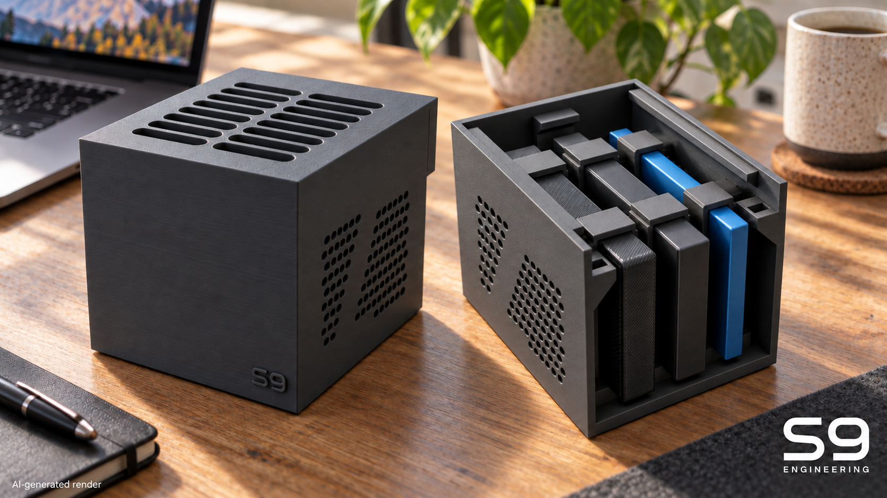
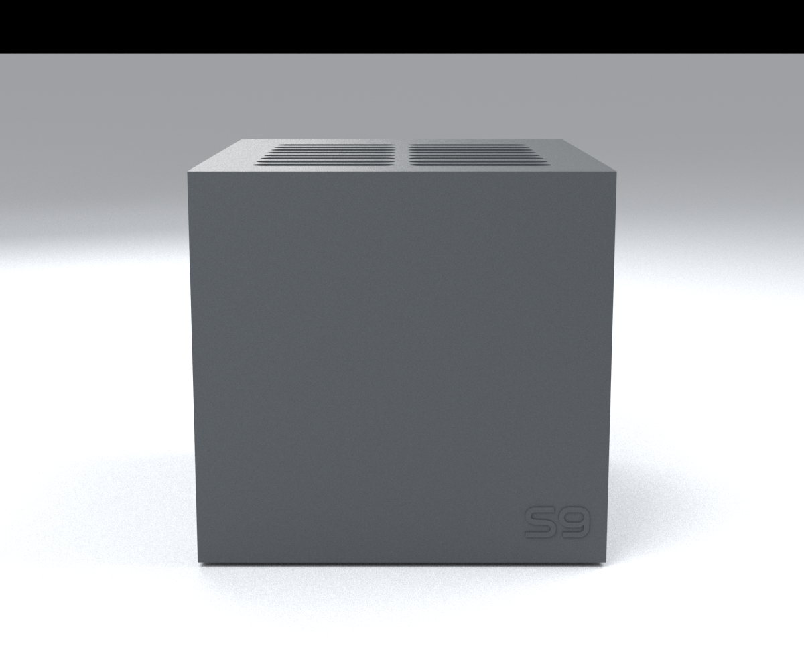
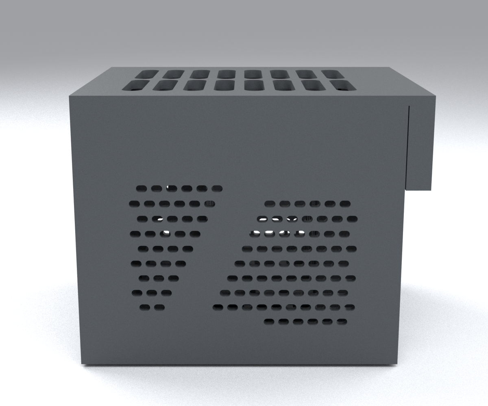
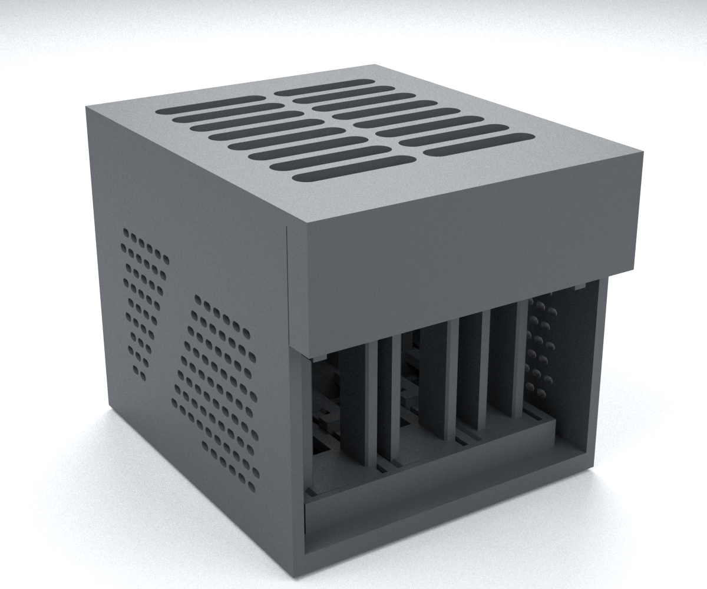

# S9 Monolith Bay — DIY 3D-Printable SSD Enclosure

### For Samsung T7, T7 Shield and T9

**Build your own** compact three-drive desktop SSD bay. Download the **STL and 3MF files**, 3D print the PLA parts and assemble an enclosure for **Samsung T7, T7 Shield and T9**, with interchangeable cartridges, passive ventilation and rear cable access.

**v1.0.0 · R27 · PLA · 8 printed components**



*AI-generated visualization of the closed bay and open enclosure with three installed SSDs. S9 Engineering signature at bottom right; AI disclosure at bottom left.*

## Product views

| Front | Side | Rear and cable access |
| --- | --- | --- |
|  |  |  |

## Compatibility and specifications

| Samsung portable SSD | Length × height × thickness | Cartridge |
| --- | --- | --- |
| **T7** | 85 × 57 × 8 mm | T7 cartridge included |
| **T7 Shield** | 88 × 59 × 13 mm | T7 Shield cartridge included |
| **T9** | 88 × 60 × 14 mm | T9 cartridge included |

Three drives stand side by side on their long edges, with their USB ports facing the open rear. Each of the three base positions accepts any of the included model-specific cartridges. The complete kit supplies one cartridge for each model above.

- **Overall size:** 90 × 109.8 × 86 mm (width × depth × height), excluding feet and external cables.
- **Enclosure:** sharp-edged monolithic shell, flat slotted roof and horizontal side ventilation pattern.
- **Cooling:** passive ventilation through the base, sides and top. Four rubber feet keep the bottom air inlets clear.
- **Access:** sliding roof on rigid guides, secured by two hidden quarter-turn pins. USB plugs and cable bends remain outside the enclosure.
- **Branding:** raised S9 on the front and S9 Engineering centred on the rear tail, 0.4 mm relief.

## What you need

### For printing

- PLA filament in your chosen colour.
- Flush cutters or a deburring tool for removing the brim.

### For assembly

**8 printed components:**

| Printed component | Quantity | Print orientation / setting | STL |
| --- | ---: | --- | --- |
| Shell | 1 | Upright; 4 walls | [shell-r27.stl](print/stl/shell-r27.stl) |
| Sliding lid with rear tail | 1 | Exterior on the build plate; Arachne | [lid-r27.stl](print/stl/lid-r27.stl) |
| Hidden locking pin | 2 | Flat; 100% rectilinear infill | [locking-pin-r27.stl](print/stl/locking-pin-r27.stl) |
| Common front cartridge stop | 1 | Upright handle; 4 walls | [cartridge-stop-r27.stl](print/stl/cartridge-stop-r27.stl) |
| T7 cartridge | 1 | Upright frames; 6 walls | [cartridge-t7-r27.stl](print/stl/cartridge-t7-r27.stl) |
| T7 Shield cartridge | 1 | Upright frames; 6 walls | [cartridge-t7-shield-r27.stl](print/stl/cartridge-t7-shield-r27.stl) |
| T9 cartridge | 1 | Upright frames; 6 walls | [cartridge-t9-r27.stl](print/stl/cartridge-t9-r27.stl) |

| Additional item | Quantity | Specification |
| --- | ---: | --- |
| Rubber feet, including transparent types | 4 | Base fitting the Ø10.5 × 0.65 mm underside recesses, with enough projection to leave **at least 5 mm of air below the bay**. A nominal 6 mm foot height is a starting selection; match the actual foot to the recess. |
| Samsung SSDs | Up to 3 | T7, T7 Shield or T9, using the corresponding cartridge. |
| USB cables | One per drive | Matching cables for your SSDs and host, connected from the rear. |

Assembly is tool-free. There are **no screws, nuts, threaded inserts or internal adhesives**. If you choose self-adhesive rubber feet, their adhesive stays in the four exterior underside recesses. Feet, drives and cables are supplied separately; there is no internal USB hub.

## Download STL and 3MF files

1. Open [GitHub Releases](https://github.com/S9-Engineering/samsung-t-series-bay/releases) and select **v1.0.0**.
2. Under **Assets**, download **`samsung-t-series-bay-v1.0.0-print-pack.zip`**, extract it and read its `README.md`.
3. Import the [separate STLs](print/stl) into your slicer in **millimetres**, keeping their supplied orientations. Use the quantities listed above, including **two copies of the locking pin**.
4. Arrange the parts for your build plate, apply your printer and PLA profile with the part settings below, and inspect the slicing preview. The supplied [reference 3MF](print/slicer/02-full-kit-r27-ecc2-pla-basic.3mf) already contains the one-plate layout and configuration described in **My setup**.
5. Print the parts, let the plate cool, and remove the brim and stray strings from the guides, cartridge openings and pin seats.

The 3MF is a complete native slicer project with saved profiles, object overrides and sliced paths. Its optional G-code in `print/gcode/` is tied to the reference configuration below. Use the separate STLs to slice for your own equipment.

The same [printing ZIP](releases/v1.0.0/assets/samsung-t-series-bay-v1.0.0-print-pack.zip) is stored in this repository. The archive includes `SHA256SUMS.txt`; the separate release checksum file verifies the downloaded ZIP with `shasum -a 256 -c samsung-t-series-bay-v1.0.0-SHA256SUMS.txt` from the download directory.

## My setup

This is the reference configuration used to prepare the included 3MF and G-code. You can use the separate STLs with your own printer and material profile.

| Item | What I used |
| --- | --- |
| Printer | ELEGOO Centauri Carbon 2 Combo |
| Printer profile | Elegoo Centauri Carbon 2 0.4 nozzle; 256 × 256 mm plate with the profile's excluded corner |
| Nozzle | 0.4 mm |
| Build plate | Textured PEI |
| Filament | ELEGOO PLA BASIC, 1.75 mm, one colour/channel |
| Slicer | ElegooSlicer 1.5.3.5, engine 2.4.2 |
| PLA enclosure setup | Front door open |
| Reference layout | All 8 printed components on one plate |
| Slicer estimate for this setup | 214.07 g / 12 h 30 min 42 s, including brim; one material, no purge tower |

| Print setting | My value |
| --- | --- |
| Layer height | 0.20 mm |
| Walls | 4 general; 6 on the drive cartridges |
| Infill | 20% gyroid; pins 100% rectilinear |
| Wall generator | Arachne on the lid for the rear lettering |
| Nozzle / textured PEI bed | 220 °C / 60 °C |
| Volumetric flow limit / bridge speed | 5 mm³/s / 25 mm/s |
| Brim | Outer, 5 mm; 0.10 mm separation |
| Elephant-foot compensation | 0.10 mm |
| Supports / raft / fuzzy skin | Disabled |

These are the saved reference values. Temperature, flow and the plate layout should follow your own printer/material configuration when you reslice. The time and consumption above are slicer estimates for this setup.

## Assembly

Gold and blue in the following images distinguish the pieces; the print project uses a single PLA colour. Drive shapes are schematic envelopes.


### Load the cartridges

1. With the USB cable unplugged, slide each drive **from the rear through both frames** of its matching cartridge: T7, T7 Shield or T9. The USB port faces the rear.
2. Choose the cartridge's position in the bay. The three base positions share the same interface, so any included cartridge can occupy any position.


### Seat the cartridges

3. Hold each cartridge **6 mm forward** of its final position, lower its foot into the base, then slide it **6 mm towards the rear** under the four short rigid tabs.
4. Lower the common front stop into the gap between the front wall and the cartridge feet. Its three lower blocks prevent forward movement; the tall handle lets you lift it out. The stop rests on the floor beside the feet.
5. Fit the four rubber feet in the underside recesses, leaving at least 5 mm of air under the base and keeping the bottom slots unobstructed.


### Connect and close

6. Connect the USB cables through the rear opening. Keep the plugs and cable bends outside the enclosure, clear of the rear tail.
7. Slide the lid forward from the rear until fully seated in both guides. Leave approximately **110 mm behind the bay** for roof removal, plus space for the natural cable bend.


8. Insert each pin **from below**, turn it **90°**, then lower it **1.1 mm** into its seat. The two receivers are mirrored; turn each pin in the direction that seats its crossbar. Both pins are identical printed parts. The image hides the shell so the locking arrangement is visible.
9. Place the bay upright on the desk with the ventilation openings clear and the cables relaxed.

### Open or remove a drive

10. Lift each pin **1.1 mm**, turn it back and remove it. Remove **both** pins before sliding the roof rearward.
11. Unplug the drive cable, lift the common front stop by its handle, slide the cartridge forward **6 mm**, and lift it out. Slide the drive out of its cartridge from the rear.

## Project files and editable CAD

The repository contains the complete project: current STL, native 3MF, matching G-code, STEP, editable CAD, render assets and retained design revisions. The release print pack contains only the complete kit and its assembly instructions.

- [Current STEP exports](cad): editable-format geometry plus a reference assembly. The assembly STEP contains the parts and drive envelopes in their installed positions; use the separate STL or native 3MF for printing.
- [R27 CAD generator](versions/bay-ssd-r27-logo-retro-80-pla/sorgenti/genera.py), [parameters](versions/bay-ssd-r27-logo-retro-80-pla/sorgenti/parametri.json), and [pinned dependencies](versions/bay-ssd-r27-logo-retro-80-pla/sorgenti/requirements.txt).
- [Retained revision index](docs/revision-history.md). Historical studies and filenames stay in their original language; use this README for v1.0.0 printing and assembly.
- [Render source](source/render_release.py) and [render dependencies](source/requirements-render.txt). [Contextual cover prompt and CAD references](assets/cover-references/cover.json).

To edit/regenerate CAD after cloning, create an environment inside this repository:

```sh
python3.11 -m venv .venv-cad
.venv-cad/bin/pip install -r versions/bay-ssd-r27-logo-retro-80-pla/sorgenti/requirements.txt
.venv-cad/bin/python versions/bay-ssd-r27-logo-retro-80-pla/sorgenti/genera.py
```

The generator writes to that revision's CAD, STL and manifest paths. Keep released files intact and save design changes as a new revision. `source/prepare_release_docs.py` recreates the English documentation, release selection and byte-identical current-file copies. No sibling project is required.

## License and attribution

No project license has been selected. S9 and S9 Engineering branding are project assets. Samsung names identify the intended devices; this is an independent enclosure design with no claim of manufacturer affiliation.
