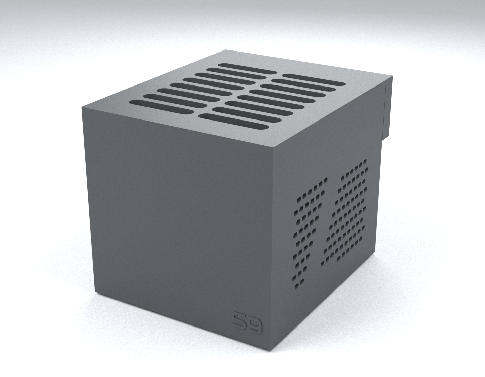
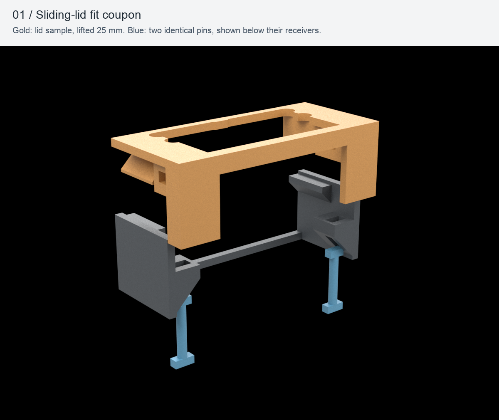

# S9 Samsung T-Series Bay

A compact, passively ventilated desktop bay for three upright Samsung portable SSDs, with interchangeable cartridges and external rear cables.

**Release: v1.0.0 · Internal revision: R27 · Material: ELEGOO PLA BASIC**

**Status: Ready for printing — digital geometry and slicing checks complete; full-kit physical and thermal validation pending.**



*Studio render of the actual R27 exported meshes. Colour and smooth shading are illustrative, not a photograph or a measured printed finish. Commercial feet and cables are omitted.*

## Product views

| Front | Side | Rear and open cable access |
| --- | --- | --- |
|  |  |  |

## Compatibility and dimensions

| Device | Nominal length × height × thickness | v1.0.0 cartridge |
| --- | --- | --- |
| Samsung T7 | 85 × 57 × 8 mm | Included |
| Samsung T7 Shield | 88 × 59 × 13 mm | Included |
| Samsung T9 | 88 × 60 × 14 mm | Included |
| Samsung T5 | Different format | **Not supported in v1.0.0**; dedicated cartridge not included |

The three base positions accept any of the included cartridges. Universality comes from swapping the model-specific cartridge, not squeezing different drives into one frame. T5 EVO and other formats are outside this release. Device dimensions are nominal; check the actual drives before a full print.

External envelope: **90 mm wide × 109.8 mm deep × 86 mm high**, excluding rubber feet and external cables. Front is Y=0; USB exits towards +Y. Slot centres are 24 mm apart. The largest nominal drive faces have a 10 mm gap, with the cartridges interrupting that space locally.

Monolithic sharp-edged shell, horizontal top slots, side ventilation pattern, small raised front S9 and centred **32 × 19.8 mm S9 Engineering** rear logo, both with 0.4 mm relief. The roof slides on rigid guides and is held by two hidden quarter-turn pins. No elastic lid arms remain.

## What you need

### Printing requirements

- ELEGOO Centauri Carbon 2 Combo, **0.4 mm nozzle**, **textured PEI** plate; the prepared layouts use the 256 × 256 mm profile and its excluded corner.
- **ELEGOO PLA BASIC**, 1.75 mm, one available colour. Allow at least **241 g** for coupon plus complete kit, then a practical reserve for loading and calibration. Charcoal in the renders is illustrative; the spool colour was not specified.
- **ElegooSlicer 1.5.3.5** (engine 2.4.2), profile **Elegoo Centauri Carbon 2 0.4 nozzle**. This is the profile name used for the confirmed Combo setup. A different printer/profile requires new slicing and checks.
- Clean, dry filament and a clean PEI plate. Flush cutters or a deburring tool for the brim; no support-removal tools are required.

### Final assembly requirements

Print the complete-kit quantities below: **8 components, 7 unique part types**. The fit coupon is separate and uses two additional copies of the same pin.

| Printed component | Quantity in final bay | Print orientation / override | STL |
| --- | ---: | --- | --- |
| Shell | 1 | Upright; 4 walls | [shell-r27.stl](print/stl/shell-r27.stl) |
| Sliding lid with rear tail | 1 | Exterior on PEI; Arachne | [lid-r27.stl](print/stl/lid-r27.stl) |
| Hidden locking pin | 2 | Flat; 100% rectilinear infill | [locking-pin-r27.stl](print/stl/locking-pin-r27.stl) |
| Common front cartridge stop | 1 | Upright handle; 4 walls | [cartridge-stop-r27.stl](print/stl/cartridge-stop-r27.stl) |
| T7 cartridge | 1 | Upright frames; 6 walls | [cartridge-t7-r27.stl](print/stl/cartridge-t7-r27.stl) |
| T7 Shield cartridge | 1 | Upright frames; 6 walls | [cartridge-t7-shield-r27.stl](print/stl/cartridge-t7-shield-r27.stl) |
| T9 cartridge | 1 | Upright frames; 6 walls | [cartridge-t9-r27.stl](print/stl/cartridge-t9-r27.stl) |

Commercial items, supplied separately:

| Item | Quantity | Specification |
| --- | ---: | --- |
| Rubber feet, including transparent types | 4 | Four recesses are Ø10.5 × 0.65 mm. Choose a foot base that fits and enough projection to leave **at least 5 mm of air below the base**; nominal 6 mm foot height is a starting point. Actual commercial feet have not been measured. |
| Portable SSDs | Up to 3 | Use the matching T7, T7 Shield or T9 cartridge; the kit contains one of each. |
| USB cables | One per installed SSD | Matching drive/host cables, connected from the open rear. No internal hub or electronics. |

The enclosure uses **no screws, nuts, threaded inserts, internal glue or adhesive pads**, and requires no assembly tools. If self-adhesive feet are selected, their adhesive is external, in the four underside recesses. Feet and cables are not printed parts.

## Downloads and print files

Open [GitHub Releases](https://github.com/S9-Engineering/samsung-t-series-bay/releases), select **v1.0.0 / R27**, and download **`samsung-t-series-bay-v1.0.0-print-pack.zip`** under **Assets**, together with its SHA-256 file. The automatic GitHub source archives contain the development history; the named print pack is the focused printing download. Keep all parts from the same release.

The same package is retained in [the repository](releases/v1.0.0/assets/samsung-t-series-bay-v1.0.0-print-pack.zip), with its [selection manifest](releases/v1.0.0/manifest.json). Editable CAD and historical revisions stay in this repository.

| Project | Parts | Native 3MF | Filament estimate | Time estimate |
| --- | ---: | --- | ---: | ---: |
| Fit coupon | 4 | [01-fit-coupon-r27-ecc2-pla-basic.3mf](print/slicer/01-fit-coupon-r27-ecc2-pla-basic.3mf) | 26.15 g | 1 h 35 min 49 s |
| Complete kit, one plate | 8 | [02-full-kit-r27-ecc2-pla-basic.3mf](print/slicer/02-full-kit-r27-ecc2-pla-basic.3mf) | 214.07 g | 12 h 30 min 42 s |

These are **native, sliced ElegooSlicer projects** with machine/material/process and object overrides, not geometry-only 3MFs. Times and consumption come from the retained actual slicing, including brim; they are not measured print results. The combined estimate is **240.22 g / 14 h 6 min 31 s**. There is no purge tower and no multicolour change.

The coupon plate contains [shell coupon](print/stl/coupon-shell-r27.stl) ×1, [lid coupon](print/stl/coupon-lid-r27.stl) ×1 and [locking pin](print/stl/locking-pin-r27.stl) ×2. The complete-kit plate already includes its own two pins.

All separate STLs are **print-oriented in millimetres**. Import one file per component, preserving the supplied orientation; duplicate the locking pin. A reference assembly STEP is not a printable plate. To change the number of each cartridge, replace that cartridge in the slicer, keep all clearances and overrides, and reslice/review the changed plate.

Optional exported G-code is included in `print/gcode/` for the exact configuration above. Prefer opening the 3MF to inspect the configuration before sending anything to the printer. G-code generated for this setup must not be reused after changing the printer, nozzle, plate or material without new slicing.

### Prepared settings

| Setting | Value |
| --- | --- |
| Layer height | 0.20 mm |
| Walls | 4 general; 6 on drive cartridges |
| Infill | 20% gyroid general; 100% rectilinear on both pins |
| Wall generator | Arachne on lid and lid coupon to preserve thin lettering; other objects retain their saved generator |
| Nozzle / textured PEI bed | 220 °C / 60 °C |
| Volumetric flow limit / bridge speed | 5 mm³/s / 25 mm/s |
| Filament / process flow ratios | 0.98 / 0.97; inherited starting values, not a new spool calibration |
| Pressure advance | 0.04; verify for the actual spool if needed |
| Brim | Outer, 5 mm; 0.10 mm separation |
| Elephant-foot compensation | 0.10 mm |
| Supports / raft / fuzzy skin | Disabled |
| Material assignment | One PLA BASIC channel for all objects; choose the actual loaded CANVAS channel |

The slicer retains one warning: **`bed_temperature_too_high_than_filament` (1000C001)**. Its 45 °C warning threshold is below the saved 60 °C bed setting. Use the documented PLA setup with the **front door open**; verify actual ambient conditions and first-layer adhesion. This warning has been reviewed, not silently removed. Other material settings remain those saved in the native project.

## How to

### Download and prepare

1. Open the Releases page above, choose the intended version and extract the named print pack. Read its root `README.md`; do not mix in older revision parts.
2. Optionally verify the download with `shasum -a 256 -c samsung-t-series-bay-v1.0.0-SHA256SUMS.txt` from the directory containing the downloaded ZIP and checksum file. Inside the extracted package, `shasum -a 256 -c SHA256SUMS.txt` checks its members.
3. Open **01-fit-coupon-r27-ecc2-pla-basic.3mf** in ElegooSlicer, retaining its project settings. Confirm the machine, 0.4 mm nozzle, textured PEI and the loaded PLA BASIC channel. Inspect the first layer and full preview. If your slicer discards a saved setting, restore it and reslice before printing.
4. Clean the plate, open the front door for PLA, run the printer's normal bed levelling and check the first layer. Let the parts and plate cool before removal. Remove brim and any stray strings without rounding the mating edges.



### Test the fit coupon first

5. Slide the lid sample into the shell sample from the rear. Both guides must engage fully without visible wall bending. In the image the gold piece is lifted only to reveal the mechanism; installation is by sliding along the guides.
6. Insert each pin **from below**, turn it **90°**, then lower it **1.1 mm** into its seat. The two receivers are mirrored; use the quarter-turn direction that seats the crossbar. The same printed pin fits either side.
7. Check that the sample lid cannot slide out with both pins seated. To unlock, lift a pin 1.1 mm, turn it back, and remove it; repeat on the other side. Try several gentle cycles. Proceed only if both sides seat, turn and release by hand without cracking, forcing or loose engagement. Record the actual fit; a CAD clearance is not a physical fit measurement.
8. Open **02-full-kit-r27-ecc2-pla-basic.3mf** and print its one plate after the coupon passes. Keep the supplied object orientations and overrides. Remove brim and strings, especially from guide entries, frame openings and pin seats.


### Load the drive cartridges

9. With the USB cable unplugged, insert each drive **from the rear through both frames** of its matching cartridge. The image uses a simplified nominal SSD envelope, without a connector or brand detailing. The nominal lateral clearance is **0.40 mm total (0.20 mm per side)**; the top allowance is **0.50 mm**. The drive should enter by hand and remain upright without rattling or spreading the frame.
10. Each model-specific cartridge can occupy any of the three identical base positions. Do not put a smaller drive in a larger cartridge and assume it will be supported. If the real drive binds, stop and check the frame opening and printer calibration before proceeding.


### Seat the cartridges and front stop

11. Position each cartridge **6 mm forward** of its final position, lower its foot into the base, then slide it **6 mm towards the rear** under the four short rigid tabs. The foot has **0.20 mm clearance per side** and **0.20 mm vertical clearance**. Do not pry or flex the tabs.
12. Lower the common front stop into the gap between the front wall and the cartridge feet. Its three lower blocks prevent the feet sliding forward; its tall handle is for removal. The stop sits on the floor **beside the feet**, not underneath them. It must sit flat, leaving each cartridge seated and upright.
13. Fit the four rubber feet in the underside recesses and verify at least 5 mm of air below the base. Keep all bottom ventilation slots clear.


### Connect the cables and close the lid

14. Connect the USB cables through the rear opening. The rear tail ends above the connector area; plugs and cable bends stay **outside the enclosure**. Nominal connector envelopes are generous **20 × 20 mm** with up to **50 mm rigid cable length**, but actual port location and cable clearance still need a physical check. Plugs must not bear on the tail or pull on the cartridges.
15. Slide the lid forward from the rear until fully seated in both guides. Leave approximately **110 mm behind the bay** for lid removal, plus the natural cable bend. Do not force it against a connector.


16. Insert both pins from below, turn each 90°, then lower it 1.1 mm into its seat, as tested on the coupon. The view hides the shell to show the two mechanisms; blue and gold are diagram colours only. No screw, spring tab or side clip must be bent.
17. Check that the lid stays seated, both pins are retained, all three drives stand upright and the cables remain accessible. The stop is gravity-seated for an upright desktop bay; the product is not qualified for inverted transport.
18. To open, lift/turn/remove **both** pins and slide the lid rearward. To remove a cartridge, unplug its cable, lift the common stop by its handle, slide the cartridge forward 6 mm, and lift it out.

### First-use check

19. Begin with an idle test, then compare the same drives and workload inside and outside the bay, especially the centre drive. Check drive temperature, throttling, stability and any PLA distortion. Bottom inlets, top exhaust slots and side openings provide a passive airflow path; airflow rate and temperature rise have not been measured. Keep the bay ventilated and away from direct heat. No fan is included or required by the assembly instructions.
20. Record material, settings, dimensions, coupon fit and full-kit observations before treating the assembly as physically validated. Recheck the pins and cartridge seating after the first warm run.

## Editable source and reproduction

All current deliverables and retained revisions live in this repository. The printable convenience copies above are byte-identical to the frozen R27 exports; [copy hashes](verification/convenience-copies.json) record the correspondence. The [revision index](docs/revision-history.md) contains historical studies and materials that are not part of the v1.0.0 print pack.

- [R27 editable CAD generator](versions/bay-ssd-r27-logo-retro-80-pla/sorgenti/genera.py), [parameters](versions/bay-ssd-r27-logo-retro-80-pla/sorgenti/parametri.json) and [pinned CAD dependencies](versions/bay-ssd-r27-logo-retro-80-pla/sorgenti/requirements.txt).
- [Current STEP exports](cad), including a reference-only assembly with 11 solids: 8 printed components plus 3 nominal drive envelopes. **Do not print the assembly STEP.**
- [Geometry, kinematics and original slicing evidence](versions/bay-ssd-r27-logo-retro-80-pla/verifiche), with the original delivery hashes retained.
- [Release reopening report](verification/release-v1.0.0.json), [visual review](verification/visual-review-v1.0.0.md), [render source](source/render_release.py) and [render provenance](verification/render-v1.0.0.json).

From the cloned repository, use Python 3.11 and a local environment; no other workspace project is needed:

```sh
python3.11 -m venv .venv-cad
.venv-cad/bin/pip install -r versions/bay-ssd-r27-logo-retro-80-pla/sorgenti/requirements.txt
.venv-cad/bin/python source/verify_release.py
```

To deliberately regenerate CAD after a design change:

```sh
.venv-cad/bin/python versions/bay-ssd-r27-logo-retro-80-pla/sorgenti/genera.py
```

The generator writes into that revision's CAD/STL/manifest paths. Preserve the release tag; make design changes on a new revision/branch, regenerate the affected artifacts, and rerun geometry and slicing checks before a new package. Existing archived manifests will no longer match if you overwrite their inputs. CAD export alone does not create a checked native slicer project.

The publication visuals can be regenerated with a separate environment:

```sh
python3.11 -m venv .venv-render
.venv-render/bin/pip install -r source/requirements-render.txt
.venv-render/bin/python source/render_release.py
```

`source/prepare_release_docs.py` reproduces the English instructions, release selection recipe and convenience copies from the retained R27 files. It does not modify the CAD or perform slicing. Historical filenames and reports are preserved in their original language for provenance.

## Verification and limits

The release verification reopened **9 STL part types**, their assembly/print-oriented STEP exports and both native 3MF projects. It checked millimetre scale, single valid solids/components, closed meshes, consistent winding, positive volume, duplicate/degenerate faces, quantities, transforms, brim spacing and the excluded bed corner. All **142 original delivery hashes** still match. The 11-solid assembly remains a reference model.

Both embedded G-code streams match the saved exports. All **145 coupon layers and 415 complete-kit layers** were reparsed for nonempty content and bed bounds; all-layer preview sheets and critical bridges, pin receivers and logo paths were reviewed. Original slicing is reused unchanged; no new slicing was needed for naming/documentation. The original self-intersection screening and R26/R27 collision sweeps are inherited for identical files, with their documented algorithm limits; they were not rerun as new physical evidence.

The user accepted an earlier internal-seat coupon and reported that a previous lid sample entered its guides. That is partial prototype feedback. The complete R27 assembly, both-pin retention, repeated cycling, frame fit on all real drives, actual USB plugs, feet, finish, PLA creep and thermal performance remain unverified physically. No printer was started by the release workflow.

## License and attribution

No project license has been selected. No open-source license is assigned by this release. S9 and S9 Engineering branding are project assets. Samsung product names identify intended devices; this is an independent enclosure project, with no claim of manufacturer affiliation.
