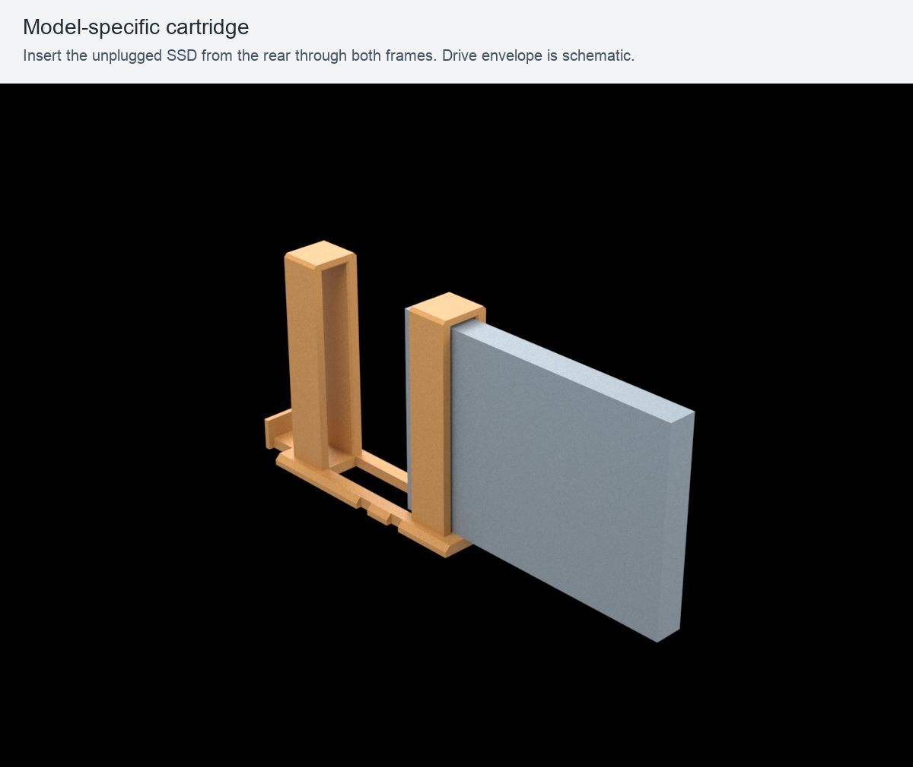
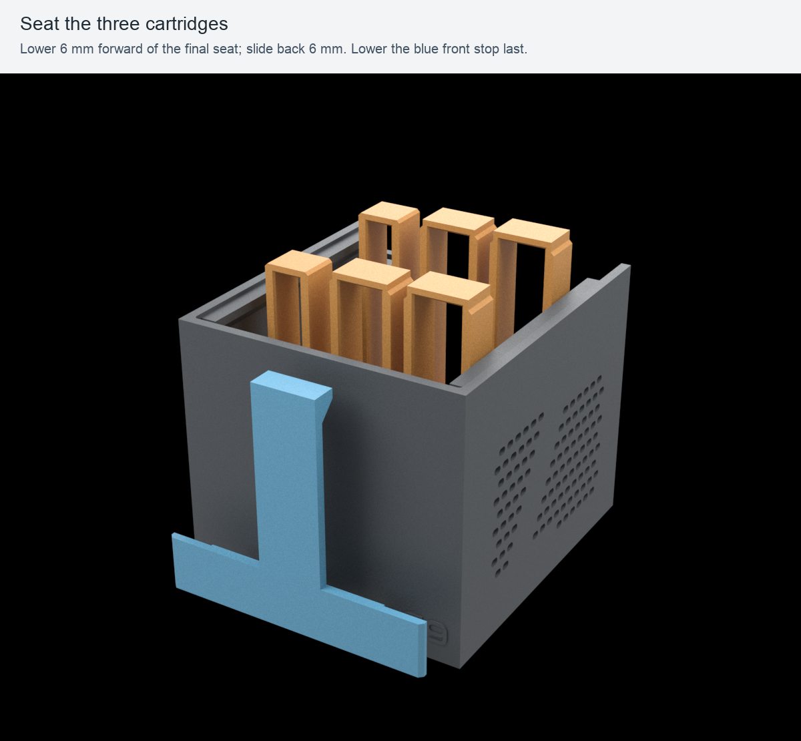
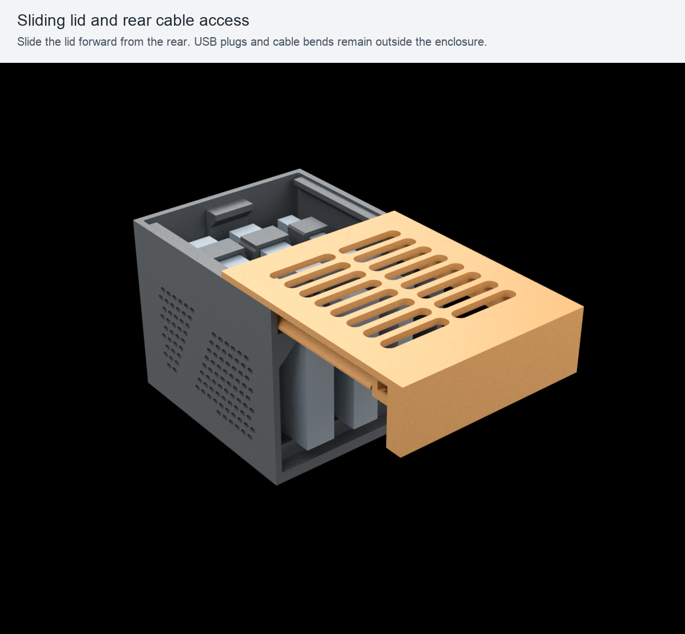
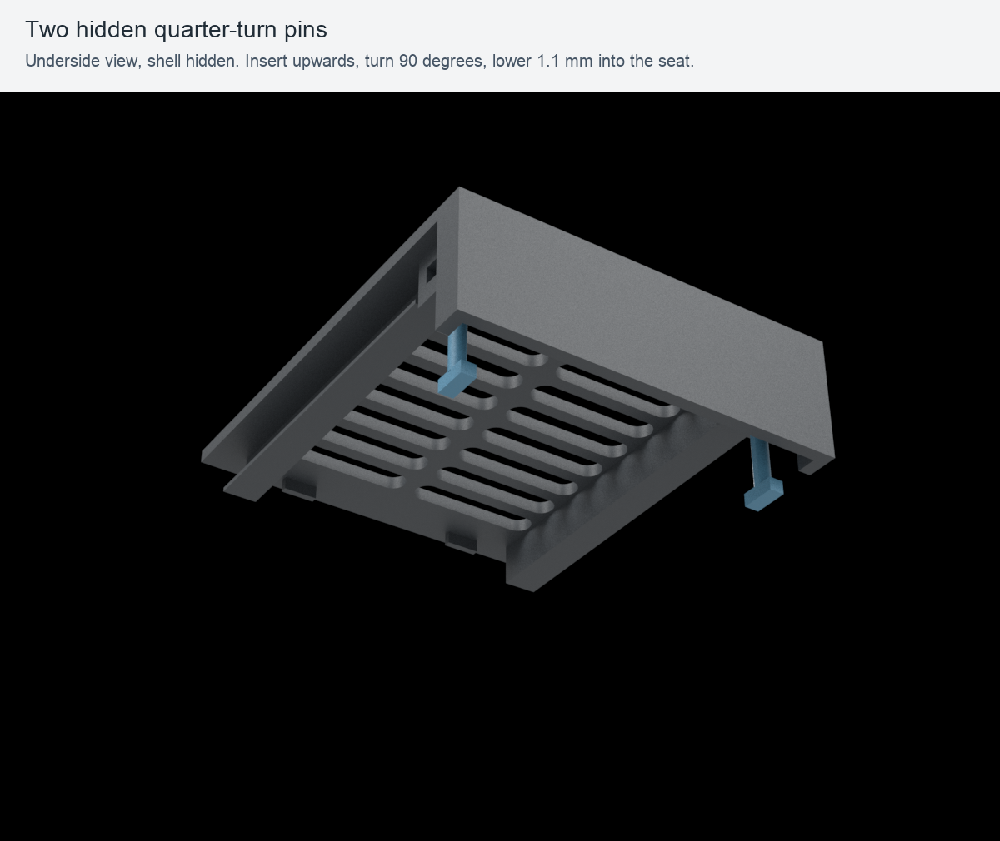

# S9 Monolith Bay — R28 print pack

DIY 3D-printable enclosure for Samsung T7, T7 Shield and T9. Current R28 uses an 83.5 mm cartridge stop and a plain rear lid. It accepts the existing R27 shell, cartridges and two pins.

Print the full-kit project once, or print just the replacement parts you need. The stop-only, lid-only and both-parts layouts are alternatives to the full kit; do not print all of them.

## Files and quantities

| Part | Quantity | Print-oriented STL |
| --- | ---: | --- |
| Shell | 1 | [shell.stl](../print/stl/shell.stl) |
| Sliding lid | 1 | [lid.stl](../print/stl/lid.stl) |
| Hidden locking pin | 2 | [locking-pin.stl](../print/stl/locking-pin.stl) |
| Cartridge stop | 1 | [cartridge-stop.stl](../print/stl/cartridge-stop.stl) |
| T7 cartridge | 1 | [cartridge-t7.stl](../print/stl/cartridge-t7.stl) |
| T7 Shield cartridge | 1 | [cartridge-t7-shield.stl](../print/stl/cartridge-t7-shield.stl) |
| T9 cartridge | 1 | [cartridge-t9.stl](../print/stl/cartridge-t9.stl) |

Native sliced projects: [full kit](../print/slicer/full-kit-ecc2-pla-basic.3mf), [stop only](../print/slicer/stop-ecc2-pla-basic.3mf), [lid only](../print/slicer/lid-ecc2-pla-basic.3mf), [stop and lid](../print/slicer/both-ecc2-pla-basic.3mf).

## What you need and how to print

1. Use PLA filament. No screws, nuts, inserts or internal adhesives are required. Reuse your existing components when replacing the stop/lid.
2. A first complete build needs four rubber feet fitting the diameter 10.5 mm x 0.65 mm underside recesses, with at least 5 mm clearance below the enclosure; up to three supported SSDs and their matching USB cables. No USB hub is included. No dimensionally verified Amazon.it foot listing was found during the 2026-10-25 sourcing check; obtain feet matching the specification rather than an assumed equivalent.
3. Open one native 3MF as a project for the reference setup below. For another machine/material profile, import the STLs in millimetres and reslice. Keep the supplied orientations: shell/cartridge frames upright; lid exterior face down; stop front face down with three blocks up; pins flat and solid.
4. Inspect the first layer and all preview layers for your setup, then print. Let the plate cool and remove the brim and stray strings from the guides and contact edges.
5. The stop's nominal side clearance is 0.25 mm per side in an 84 mm cavity. Reuse existing shell/cartridges/pins; do not force the stop against the walls.

## My setup

This is the reference configuration used to prepare the included 3MF and G-code. You can use the separate STLs with your own printer and material profile.

| Item | What I used |
| --- | --- |
| Printer | ELEGOO Centauri Carbon 2 Combo |
| Printer profile | Elegoo Centauri Carbon 2 0.4 nozzle; 256 × 256 mm plate with the profile's excluded corner |
| Nozzle | 0.4 mm |
| Build plate | Textured PEI |
| Filament | ELEGOO PLA BASIC, 1.75 mm, one colour/channel |
| Slicer | ElegooSlicer 1.5.3.5, engine 2.4.2 |
| PLA enclosure setup | Front door open |
| Reference layout | All 8 printed components on one plate |
| Slicer estimate for this setup | 12 h 23 min 19 s / 213.41 g, including brim; one material, no purge tower |

| Print setting | My value |
| --- | --- |
| Layer height | 0.20 mm |
| Walls | 4 general; 6 on the drive cartridges |
| Infill | 20% gyroid; pins 100% rectilinear |
| Wall generator | Arachne on the lid |
| Nozzle / textured PEI bed | 220 °C / 60 °C |
| Volumetric flow limit / bridge speed | 5 mm³/s / 25 mm/s |
| Brim | Outer, 5 mm; 0.10 mm separation |
| Elephant-foot compensation | 0.10 mm |
| Supports / raft / fuzzy skin | Disabled |

The saved project retains the slicer warning `bed_temperature_too_high_than_filament` for the 60 °C bed setup; keep the front door open as listed above. No other slice warning was accepted.

These are the saved reference values. Temperature, flow and the plate layout should follow your own printer/material configuration when you reslice. The time and consumption above are slicer estimates for this setup.

## How to assemble

Gold and blue in the following images distinguish the pieces; the print project uses a single PLA colour. Drive shapes are schematic envelopes.

### Load the cartridges

1. With the USB cable unplugged, slide each drive **from the rear through both frames** of its matching cartridge: T7, T7 Shield or T9. The USB port faces the rear.
2. Choose the cartridge's position in the bay. The three base positions share the same interface, so any included cartridge can occupy any position.

### Seat the cartridges

3. Hold each cartridge **6 mm forward** of its final position, lower its foot into the base, then slide it **6 mm towards the rear** under the four short rigid tabs.
4. Lower the **83.5 mm common front stop** into the gap between the front wall and the cartridge feet, with its three lower blocks pointing towards the cartridge tongues. It rests on the floor beside the feet; nothing goes underneath them. The nominal side travel is **0.50 mm total**. The added ends clear the internal corner radii and upper roof guides; lift it straight up using the original handle.
5. Fit the four rubber feet in the underside recesses, leaving at least 5 mm of air under the base and keeping the bottom slots unobstructed.

### Connect and close

6. Connect the USB cables through the rear opening. Keep the plugs and cable bends outside the enclosure, clear of the rear tail.
7. Slide the lid forward from the rear until fully seated in both guides. Leave approximately **110 mm behind the bay** for roof removal, plus space for the natural cable bend.

8. Insert each pin **from below**, turn it **90°**, then lower it **1.1 mm** into its seat. The two receivers are mirrored; turn each pin in the direction that seats its crossbar. Both pins are identical printed parts. The image hides the shell so the locking arrangement is visible.
9. Place the bay upright on the desk with the ventilation openings clear and the cables relaxed.

### Open or remove a drive

10. Lift each pin **1.1 mm**, turn it back and remove it. Remove **both** pins before sliding the roof rearward.
11. Unplug the drive cable, lift the common front stop by its handle, slide the cartridge forward **6 mm**, and lift it out. Slide the drive out of its cartridge from the rear.

## Integrity and licensing

Verify the extracted files with `shasum -a 256 -c SHA256SUMS.txt` from this folder. Optional G-code is specific to the reference setup above. Original designs/documentation: [CC BY-NC-SA 4.0](../LICENSE.txt). Original S9 software: [PolyForm Noncommercial 1.0.0](../LICENSE-SOFTWARE.txt). See [scope and branding terms](../LICENSING.md).

Geometry and actual slicing were checked. No complete R28 physical fit, endurance or thermal test is claimed. Published v1.0.0 remains R27; this current package does not replace its assets.
