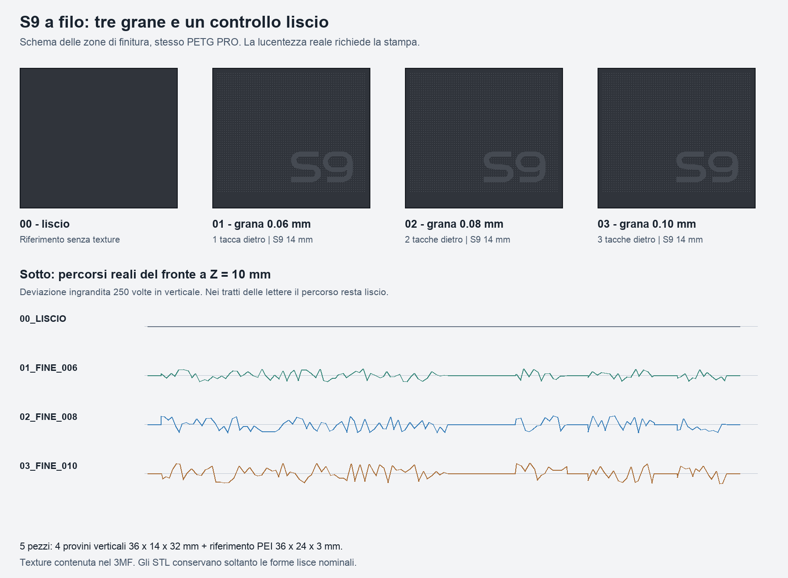

# Provini Fuzzy Skin e S9 a filo — R01

**Pronto per la stampa dei provini** quando la revisione visiva in `verifiche/STATO_CONSEGNA.json` risulta completata. Il progetto serve a scegliere la grana e valutare un logo S9 più liscio e riflettente, senza rilievo, sul fondo ruvido. Non sostituisce né modifica il bay R12. Nessuna stampa è stata avviata.



## Aprire questo file

Aprire in **ElegooSlicer 2.4.2** il progetto già preparato:

`stampa/progetti_ElegooSlicer/PROVINI_FUZZY_S9_R01_ECC2_PETGPRO.3mf`

È un vero progetto dello slicer: conserva macchina, materiale, impostazioni, disposizione, modificatori selettivi e percorsi calcolati. Gli STL separati conservano solo le forme nominali lisce: **importando soltanto gli STL si perdono sia Fuzzy Skin sia il logo a filo**. Non stampare la maschera CAD: è un volume modificatore, non un pezzo.

## Cosa c'è sul piatto

| Campione | Tacche sul bordo posteriore del piede | Ampiezza Fuzzy Skin | Distanza punti | Quantità |
| --- | ---: | ---: | ---: | ---: |
| 00 liscio | 0 | disattivata | — | 1 |
| 01 fine | 1 | 0,06 mm | 0,25 mm | 1 |
| 02 fine | 2 | 0,08 mm | 0,25 mm | 1 |
| 03 fine | 3 | 0,10 mm | 0,25 mm | 1 |
| Riferimento PEI | — | disattivata | — | 1 |

Quattro pannelli verticali **36 × 14 × 32 mm**, parete **3 mm**, piede **2,4 mm**. Le tacche sono sul retro del piede e permettono di riconoscere i campioni anche dopo averli staccati. Il riferimento PEI misura **36 × 24 × 3 mm**: la faccia da confrontare con il tetto è quella che tocca il piano.

Il campo ruvido occupa X=1…35 mm e Z=3,4…31 mm del solo fronte. Il bordo resta liscio, come il retro, il piede e i lati. Si varia solo l'ampiezza: distanza dei punti, materiale e condizioni di stampa sono uguali per rendere il confronto interpretabile. Sono valori di prova, non una finitura già calibrata.

## Logo liscio, senza spessore

S9 conserva il disegno approvato del progetto R12: larghezza **14 mm**, margine destro **4 mm**, margine inferiore **6 mm**. Il rilievo nominale è **0 mm**. Nei tre campioni ruvidi il logo è una zona esclusa dalla texture; anche il vuoto interno al 9 rimane ruvido. Nel controllo completamente liscio il logo non si distingue, perché manca il contrasto.

Il principio è ottenere una superficie relativamente più liscia e riflettente sul fondo granuloso, tono su tono e con un solo filamento. Restano le righe degli strati della parete verticale: **liscio non significa lucidato a specchio**. Lucentezza, contrasto sotto luce radente e sensazione al tatto devono essere valutati con il PETG reale. La grana ha piccole deviazioni dentro e fuori dalla parete nominale: il logo è a filo del piano nominale, non di ogni singolo picco.

Questa prova usa modificatori di texture. Non richiede inserti, incollaggio, cambi colore, vernici o lavorazioni successive. La riuscita ottica va scelta sui campioni prima di applicarla al case completo.

## Configurazione e stampa

Configurazione già confermata dall'utente per il bay: **ELEGOO Centauri Carbon 2 Combo, ugello 0,4 mm, piano PEI testurizzato, ELEGOO PETG PRO**. Profili macchina e materiale derivati dalla R12; nessuna modifica ai macro della macchina o all'offset dell'estrusore.

| Impostazione | Valore preparato |
| --- | --- |
| Orientamento | Piede dei pannelli sul piano, fronte verticale; piastrina PEI piatta |
| Altezza strato / primo strato | 0,20 / 0,20 mm |
| Pareti | 4 |
| Riempimento | 20% gyroid |
| Ugello / piano | 240 / 65 °C |
| Portata massima | 5 mm³/s |
| Supporti | Disattivati |
| Adesione | Brim esterno 5 mm, distacco 0,1 mm |
| Texture | Displacement, rumore Classic; primo strato escluso |
| Risoluzione percorsi | 0,001 mm, per conservare i passaggi fini fra logo e texture |
| Materiali e CANVAS | Un solo PETG PRO per tutto il piatto; nessun cambio o torre di spurgo |

Temperature e flusso sono impostazioni iniziali ereditate, non una calibrazione del lotto di filamento. Usare lo stesso colore e la stessa bobina per confrontare i campioni. Materiale asciutto e piano preparato secondo le istruzioni della macchina e del filamento. Non aumentare la temperatura per cercare più lucentezza durante questo confronto: cambierebbe una seconda variabile.

Lo slicing effettivo restituisce **160 strati, 23,30 g e 1 h 18 min 21 s**, includendo il brim. Sono stime di ElegooSlicer, non tempi o pesi misurati. Il volume nominale è 256 × 256 × 256 mm; profilo, zona esclusa 246…256 × 0…20 mm e ingombri con brim sono stati controllati. I pannelli non richiedono supporti o montaggio.

Dopo raffreddamento rimuovere il brim senza abradere il fronte. Osservare i campioni prima sotto luce diffusa, poi con una lampada di lato, inclinandoli insieme. Confrontare grana, tracce degli strati, leggibilità dei due glifi e piccoli bordi. Per il riferimento PEI guardare la faccia inferiore. Scegliere poi un solo campione da trasferire al bay completo.

## Verifiche e limiti

- STL e STEP riaperti: scala, dimensioni, un solido per pezzo, mesh chiuse, normali coerenti, volumi positivi, nessuna faccia degenere o duplicata; screening di autointersezioni superato con i limiti documentati nel rapporto.
- 3MF finale riaperto con lettura XML indipendente per ID e trasformazioni: **5 pezzi stampabili e 3 modificatori**. Ogni maschera contiene due componenti intenzionali, campo principale e interno del 9. Confronto dei corpi stampabili con gli STL superato.
- Percorsi calcolati con ElegooSlicer 2.4.2: nessun avviso CLI/modello, nessuna invasione del piano o zona esclusa, nessun candidato a isola sospesa nel controllo approssimato.
- Controllo numerico dei percorsi: texture presente solo nel campo previsto, S9 e retro lisci. La tolleranza di semplificazione iniziale da 0,012 mm è stata ridotta a 0,001 mm per evitare semplificazioni dei raccordi tra le due finiture.
- Tutti gli strati sono nelle tavole di `verifiche/slicing/anteprime/`; la revisione effettiva è registrata con hash del progetto e delle immagini.

Nessuna prova fisica, nessuna garanzia di effetto identico alla Xbox, nessuna misura di lucentezza o rugosità. I provini confrontano finiture; non validano incastri, fit degli SSD o prestazioni termiche del bay.

## Sorgenti e rigenerazione

Millimetri per CAD, STL e 3MF. Le geometrie di base sono modificabili in `CAD/`; parametri e maschera sono in `sorgenti/`. Il file CAD `MASCHERA_NON_STAMPABILE_FUZZY.step` non deve essere stampato. Il disegno S9 viene dai contorni vettoriali approvati della R12, inclusi nel pacchetto.

Dipendenze geometriche in `sorgenti/requirements.txt`; per le anteprime viene usato anche Pillow, incluso nella stessa lista. Per rigenerare da questa cartella, con un ambiente Python configurato:

```sh
python sorgenti/prepara.py --slice --slicer /percorso/ElegooSlicer
python sorgenti/controlla.py
```

Il primo comando prepara le esportazioni e ricalcola lo slicing; il secondo ricontrolla il progetto esportato e genera le tavole. Dopo una rigenerazione la revisione visiva deve essere ripetuta e registrata prima di dichiarare nuovamente i file pronti per la stampa. Nessuno script invia file alla stampante.

Riferimenti: [Fuzzy Skin, documentazione Prusa](https://help.prusa3d.com/article/fuzzy-skin_246186), [parametri Fuzzy Skin, progetto OrcaSlicer](https://github.com/OrcaSlicer/OrcaSlicer/wiki/others_settings_fuzzy_skin), [ELEGOO PETG PRO](https://www.elegoo.com/products/petg-pro-filament-1-75mm-colored-1kg), [Centauri Carbon 2 Combo](https://www.elegoo.com/products/centauri-carbon-2-combo). La compatibilità in questa consegna è verificata con il programma ElegooSlicer locale e con i profili inclusi; non dipende dalla disponibilità di opzioni nelle versioni recenti di altri slicer.
