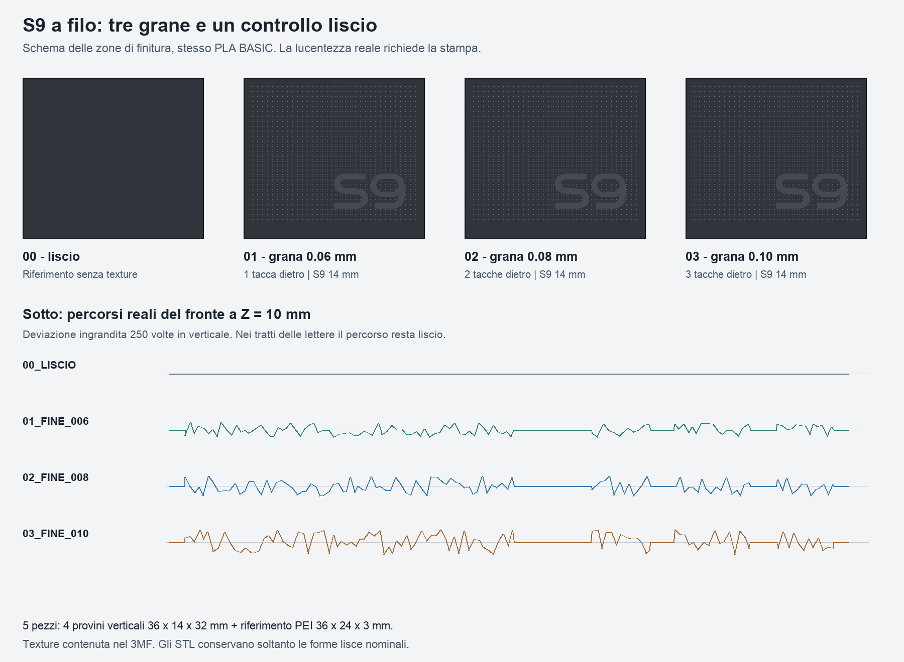

# Provini Fuzzy Skin e S9 a filo — R02 PLA BASIC

**Variante per ELEGOO PLA BASIC**, da stampare separatamente dai provini R01 in PETG PRO. Stessa geometria, stessa disposizione e stessi parametri della grana, con profilo materiale specifico per Centauri Carbon 2 Combo. Stato conclusivo in `verifiche/STATO_CONSEGNA.json`. Nessuna stampa fisica o invio alla macchina.

Aprire in **ElegooSlicer** il file:

`stampa/progetti_ElegooSlicer/PROVINI_FUZZY_S9_R02_ECC2_PLABASIC.3mf`

È un vero progetto dello slicer con profili, disposizione, modificatori selettivi e percorsi calcolati. **Usare il 3MF per conservare la Fuzzy Skin e il logo a filo.** Gli STL separati contengono solo le forme lisce nominali; importandoli da soli si perdono texture e S9. La maschera CAD non è un pezzo da stampare.



## Cinque pezzi sullo stesso piatto

| Campione | Tacche sul retro del piede | Ampiezza Fuzzy Skin | Distanza punti | Copie |
| --- | ---: | ---: | ---: | ---: |
| 00 liscio | 0 | disattivata | — | 1 |
| 01 fine | 1 | 0,06 mm | 0,25 mm | 1 |
| 02 fine | 2 | 0,08 mm | 0,25 mm | 1 |
| 03 fine | 3 | 0,10 mm | 0,25 mm | 1 |
| Riferimento PEI | — | disattivata | — | 1 |

I pannelli verticali misurano **36 × 14 × 32 mm**, parete 3 mm e piede 2,4 mm. Il riferimento PEI misura **36 × 24 × 3 mm**: osservare la faccia inferiore, quella che tocca il piano, per confrontare la finitura che riceverà il tetto del bay.

S9 conserva il disegno approvato, larghezza **14 mm**, margine destro **4 mm**, margine inferiore **6 mm**, rilievo nominale **0 mm**. Nei tre campioni ruvidi le lettere sono escluse dalla texture; il vuoto interno al 9 resta ruvido. Nel campione 00 completamente liscio il logo non si distingue, perché manca il contrasto di finitura.

La grana occupa solo il fronte, entro X=1…35 mm e Z=3,4…31 mm. Bordi, lati, retro e piede restano lisci. La Fuzzy Skin sposta localmente il cordone dentro e fuori dal piano nominale: S9 è a filo del piano della parete, non di ogni picco della grana. Le righe degli strati restano anche nelle lettere lisce: questa è una prova di contrasto fra finiture, non una lucidatura a specchio.

## Impostazioni PLA preparate

Configurazione hardware già confermata: **ELEGOO Centauri Carbon 2 Combo, ugello 0,4 mm, piano PEI testurizzato**. Filamento confermato per questa variante: **ELEGOO PLA BASIC**. Il colore non è stato specificato: il grigio delle anteprime è indicativo.

Il profilo deriva da **Elegoo PLA Basic @ECC2**, con ereditarietà risolta e conservata nel pacchetto. La compatibilità include esplicitamente **Elegoo Centauri Carbon 2 0.4 nozzle**. Slicing con ElegooSlicer installato sul Mac: versione CLI/motore **2.4.2**, versione del bundle **1.5.3.5**.

| Impostazione | Valore |
| --- | --- |
| Ugello, primo e altri strati | **220 °C** |
| Piano PEI, primo e altri strati | **60 °C** |
| Strato / primo strato | 0,20 / 0,20 mm |
| Pareti | 4 |
| Riempimento | 20% gyroid |
| Velocità parete esterna / interna | 60 / 80 mm/s |
| Limite di portata | **5 mm³/s**, uguale alla R01 PETG |
| Supporti | Disattivati |
| Brim esterno | 5 mm, distacco 0,1 mm |
| Fuzzy Skin | Displacement, rumore Classic, primo strato escluso |
| Tolleranza di semplificazione dei percorsi | 0,001 mm |
| Filamenti / torre di spurgo | Un solo PLA BASIC / nessuna torre |

220/60 °C provengono dal profilo locale del produttore e rientrano negli intervalli ELEGOO per PLA BASIC: **190–230 °C ugello e 35–65 °C piano**. Il limite originale di portata è 21 mm³/s; qui è ridotto a 5 mm³/s per mantenere condizioni di movimento comparabili ai campioni PETG. Raffreddamento, flow ratio e pressure advance provengono dal profilo PLA: non sono stati copiati dal PETG. Le impostazioni non costituiscono una calibrazione della singola bobina.

### Preparazione della macchina

1. Caricare **ELEGOO PLA BASIC** e verificare sul progetto la macchina ECC2 Combo, ugello 0,4 e piano PEI testurizzato.
2. Preparare il piano secondo le istruzioni della macchina; per questa prova non occorrono adesivi sui pezzi o montaggi.
3. **Stampare con lo sportello anteriore aperto**, evitando accumulo di calore nella camera. Il profilo PLA conserva una soglia software di 45 °C e lo slicer segnala che il piano a 60 °C la supera. È l'avviso di ventilazione della camera, non un errore nella temperatura del piano. La soglia non è stata alzata per nasconderlo. Riferimento: [documentazione OrcaSlicer sulla temperatura di rammollimento](https://github.com/OrcaSlicer/OrcaSlicer/wiki/material_basic_information).
4. Usare filamento in buone condizioni e asciutto. Se serve essiccazione, seguire le indicazioni della bobina e del produttore; non è stato impostato un ciclo automatico di essiccazione.
5. Tutti i pezzi sono già orientati: piedi dei pannelli sul piano, fronte verticale, riferimento PEI piatto. Non occorrono supporti, viti o assemblaggio.

Stima dello slicing effettivo: **160 strati, 23,30 g e 1 h 18 min 21 s**, includendo il brim. La massa usa la densità 1,25 g/cm³ del profilo del produttore; non è un peso misurato. Le stime coincidono con la R01 PETG perché geometria, velocità/portata limite e densità del profilo sono uguali; temperature e raffreddamento sono differenti.

## Come confrontare PLA e PETG

Lasciare raffreddare, poi togliere il brim senza carteggiare i fronti. Affiancare i campioni con lo stesso numero di tacche: 0 con 0, 1 con 1, 2 con 2, 3 con 3. Se possibile usare colori vicini, perché il colore influenza la percezione del riflesso. Osservare prima con luce diffusa, poi con una lampada laterale, inclinando insieme i due pezzi.

Valutare la grana al tatto, la visibilità delle righe, il riflesso di S9, la leggibilità separata di S e 9 e la pulizia del passaggio fra fondo e lettere. Sul riferimento PEI osservare la faccia a contatto con il piano. Il confronto serve a scegliere una finitura: non valida temperatura di esercizio, incastri o funzionamento del bay completo.

La R01 PETG PRO resta nella propria cartella originale. Il rapporto `verifiche/confronto_PLA_PETG.json` controlla che le cinque geometrie, il disegno S9, la disposizione, i parametri della grana, il profilo macchina e il processo siano equivalenti. Le differenze necessarie del materiale sono elencate nel rapporto. Non è previsto mescolare PLA e PETG nello stesso piatto.

## Controlli e stato

STEP e STL finali riaperti: unità mm, dimensioni, componenti, mesh chiuse, normali e volumi positivi; facce degeneri/duplicate e screening delle autointersezioni controllati. Il 3MF nativo è analizzato per ID e trasformazioni, distinguendo **5 pezzi stampabili da 3 modificatori non stampabili**. Ciascuna maschera ha due componenti intenzionali: fondo e interno del 9.

Slicing completato con i profili inclusi. Zero avvisi geometrici; avviso termico PLA conservato e gestito con la preparazione dello sportello aperto descritta sopra. Controllati gli ingombri con brim nel piano 256 × 256 mm e rispetto alla zona esclusa del profilo. Percorsi verificati per grana e zone lisce; esame di tutti i 160 strati nelle quattro tavole più due immagini di dettaglio, registrato dopo l'ispezione in `verifiche/revisione_visiva.json`.

**Nessun campione è stato stampato o misurato.** Lucentezza reale, rugosità e qualità fisica rimangono da verificare. Le illustrazioni sono schemi; i grafici dei percorsi sono dati dello slicing, non fotografie o previsioni ottiche.

## Sorgenti e rigenerazione

`CAD/` contiene STEP modificabili; `stampa/STL/` cinque pezzi separati; `sorgenti/` parametri, contorni S9, script e dipendenze. `CAD/MASCHERA_NON_STAMPABILE_FUZZY.step` è soltanto un modificatore. I profili originali e la catena di ereditarietà sono conservati in `slicer/` e descritti in `verifiche/provenienza_profili.json`.

Con Python e le dipendenze di `sorgenti/requirements.txt`:

```sh
python sorgenti/prepara.py --slice --slicer /Applications/ElegooSlicer.app/Contents/MacOS/ElegooSlicer
python sorgenti/controlla.py
```

Il confronto con la R01 può essere ripetuto con `python sorgenti/confronta_materiali.py`, affiancando la cartella originale. Dopo una rigenerazione ripetere e registrare la revisione visiva prima di ricreare la consegna. Nessuno script avvia la stampa o invia file alla macchina.

Riferimenti materiale: [ELEGOO PLA BASIC](https://www.elegoo.com/products/pla-basic-filament-1-75mm-colored-1kg), [specifiche PLA BASIC del sito ELEGOO UK](https://uk.elegoo.com/products/pla-basic-filament-1-75mm-colored-1kg), [Fuzzy Skin](https://help.prusa3d.com/article/fuzzy-skin_246186).
