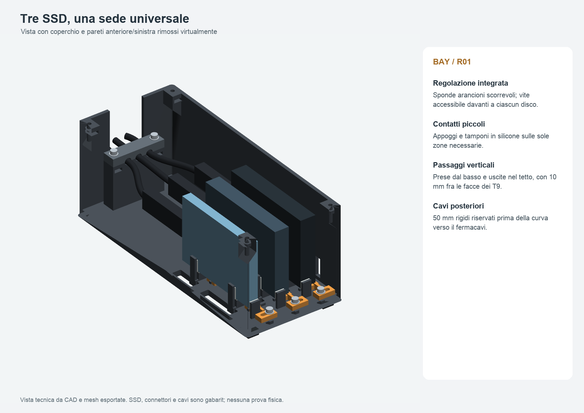

# Bay universale per tre SSD — R01

Tre SSD Samsung affiancati, appoggiati sul lato lungo, USB rivolta al retro. Tutti i tre slot accettano i gabarit nominali di **T7, T7 Shield e T9**. Scocca ventilata, coperchio superiore rimovibile, sponde regolabili, piccoli contatti in silicone e fermacavi apribile.

**Revisione da usare: R01. Prima stampare il provino.** Stato effettivo in `verifiche/STATO_CONSEGNA.json`. Accoppiamento reale e comportamento termico restano da verificare. Nessuna stampa fisica avviata.



## Quote e dati di partenza

Tutte le quote sono in millimetri. Ingombro **90 × 216 × 91 mm**, inclusi quattro piedini commerciali alti 5 mm; corpo rigido alto 86 mm. La sporgenza esterna dei cavi non è inclusa.

| SSD | Fronte–retro | Altezza in sede | Spessore |
| --- | ---: | ---: | ---: |
| T7 | 85 | 57 | 8 |
| T7 Shield | 88 | 59 | 13 |
| T9 | 88 | 60 | 14 |

Dimensioni nominali dalla [scheda Samsung](https://download.semiconductor.samsung.com/resources/brochure/Samsung_Portable_SSD_Brochure.pdf), non rilevate al calibro. I gabarit rettangolari sono conservativi; non riproducono tutti i raccordi o la gomma reale. Custodie aggiuntive escluse.

Conferme dell'utente del 20 ottobre 2026:

- ELEGOO Centauri Carbon 2 Combo, ugello **0,4 mm**, **PEI testurizzato**, **ELEGOO PETG PRO**.
- Cavi originali dritti: fino a **circa 50 mm** prima della parte flessibile, diametro **circa 5 mm**.

La profondità supera l'ipotesi iniziale 150–175 mm per conservare i 50 mm rettilinei e una curva verso l'uscita comune. Le curve matematiche rispettano l'obiettivo progettuale di raggio 25 mm; **non è un raggio certificato dal produttore dei cavi**. Forma e posizione esatte di spine e porte non sono misurate: l'inviluppo dello spinotto è provvisoriamente **9 × 50 × 16 mm**. Prevale sempre il rilievo dei componenti reali.

## Sedi e aria

- Passo **24 mm**; con tre T9: **10 mm fra le facce**, **11 mm verso le pareti esterne interne**.
- SSD a **8 mm sopra il piano interno** della base, inclusi gli appoggi morbidi; **10 mm fra T9 e tetto**.
- Due appoggi 8 × 8 mm per sede, a 20 e 68 mm dal fronte del disco. Sotto il T9 sostengono 8 dei 14 mm di spessore; il baricentro nominale resta dentro l'appoggio. Non è una prova contro trazioni dei cavi.
- Due contatti fissi e due mobili per sede. Le facce grandi rimangono quasi interamente libere.
- Apertura fra tamponi circa **7,8–14,6 mm**; impostazione nominale spessore SSD + **0,2 mm totali**, non per lato.
- Guide: **0,3 mm per lato**, **0,4 mm verticale**. Sono valori iniziali da provare sul materiale reale.
- La vite anteriore blocca la sponda contro la base; non avvita una punta contro il disco. Accostare senza deformare SSD o gomma.
- Base ventilata, prese laterali inferiori e aperture nel tetto. Collegamenti pieni locali sotto le guide evitano frammenti separati.
- Coperchio distanziato, senza pressione dall'alto. Uso da scrivania; non trasportare il bay carico afferrandolo dal coperchio.

`verifiche/aria.json` misura i passaggi geometrici, **non portata, CFD o prestazioni termiche**.

## File e quantità

| STL in `stampa/STL/` | Kit | Provino separato | Orientamento già esportato |
| --- | ---: | ---: | --- |
| `scocca_ventilata_R01.stl` | 1 | — | fondo sul piano |
| `sponda_regolabile_R01.stl` | 3 | 1 aggiuntiva | piedi della guida sul piano |
| `coperchio_ventilato_R01.stl` | 1 | — | faccia esterna sul piano |
| `cappello_fermacavi_R01.stl` | 1 | — | faccia superiore sul piano |
| `provino_sede_R01.stl` | — | 1 | fondo sul piano |

Controllare scala all'importazione degli STL: scocca **90 × 216 × 83 mm**, provino **31 × 106 × 25 mm**. Gli STL non codificano l'unità.

- `stampa/piatti_geometrici/`: 3MF **solo geometria**, unità millimetri, nessun profilo.
- `stampa/progetti_ElegooSlicer/`: veri progetti con profili e percorsi prodotti dallo slicer, quando confermati nel report di consegna.
- `CAD/`: STEP per pezzo, STEP orientati per stampa e assieme con gabarit. **L'assieme completo non va stampato**.
- `anteprime/`: interno, assieme chiuso, retro, pianta e disposizione dei piatti.
- `verifiche/mesh_assieme/`: mesh di lavoro per le verifiche, non pezzi aggiuntivi.

L'arancione delle sponde serve a distinguerle nelle anteprime. Tutti i piatti usano un solo filamento: nessun cambio colore o torre CANVAS.

## Componenti commerciali

| Componente | Quantità kit |
| --- | ---: |
| M3 × 10, testa cilindrica a brugola | 3 |
| M3 × 12, testa svasata DIN 7991 | 4 |
| M3 × 16, testa cilindrica a brugola | 2 |
| Dado M3 standard, chiave 5,5 mm, altezza circa 2,4 mm | 9 |
| Rondella M3, esterno massimo 7 mm, spessore circa 0,5 mm | 5 |
| Piedino silicone adesivo 10 × 10 × 5 mm | 4 |
| Silicone adesivo 1 mm, 8 × 8 mm: appoggi | 6 |
| Silicone adesivo 1 mm, 6 × 10 mm: contatti laterali | 12 |
| Silicone adesivo 1 mm, 8 × 6 mm: battute anteriori | 3 |
| Silicone adesivo 0,5 mm: semicanali del fermacavi | 6 |

Rivestimenti dei canali: ritagli iniziali circa **10 × 9 mm**, senza sovrapposizioni. Il canale rigido ha diametro 6 mm; due strati da 0,5 mm danno passaggio nominale 5 mm. Provare sulla guaina reale; le battute rigide limitano la chiusura. Se il cavo si schiaccia, modificare rivestimento o canale, senza forzare.

Per conservare il provino assemblato: **1 M3 × 10, 1 dado e 1 rondella aggiuntivi**, sette tamponi come una sede e due strisce di rialzo sotto il fondo alte almeno 2 mm. Proteggono la scrivania dalla coda della vite. Tasche per dadi standard, non nyloc o inserti termici.

## Stampa

Configurazione confermata sopra, profili espansi in `slicer/` e provenienza in `verifiche/provenienza_profili.json`. Non sostituire con un profilo della Centauri Carbon originale.

Valori iniziali: **strato 0,20 mm, quattro pareti, 20% gyroid, brim esterno 5 mm, supporti disattivati**, stampa per strati. ELEGOO PETG PRO: **240 °C / PEI 65 °C**, portata massima **5 mm³/s**. Sono impostazioni preparate; il nuovo pezzo non è fisicamente calibrato.

La [pagina ELEGOO PETG PRO](https://eu.elegoo.com/products/petg-pro-filament-1-75mm-colored-1kg) raccomanda essiccazione a 60 °C per 8 ore; verificare etichetta/scheda della bobina effettiva e usare attrezzatura adatta. Curare umidità, fili residui e distacco dal PEI.

Finestre dei dadi e scanalature richiedono piccoli ponti. Non cambiare l'orientamento del coperchio e del fermacavi. I piatti considerano brim, margini e zona esclusa del profilo **246–256 × 0–20 mm**. Tempi e consumo reali dello scenario di slicing in `verifiche/slicing/riepilogo.json`, separati fra kit e provino.

## Provino e montaggio

1. Stampare prima `BAY_R01_00_PROVINO_PRIMA_DI_TUTTO`. Rimuovere brim, bave e piede d'elefante senza alterare arbitrariamente gli incastri.
2. Inserire il dado dal fondo, sponda sulle due guide, vite M3 × 10 e rondella allentate. Applicare sette tamponi e rialzi inferiori.
3. Provare separatamente i tre SSD scollegati: appoggio, presa per estrazione, scorrimento e blocco leggero. La sponda non deve inarcarsi. Se i giochi non funzionano, correggere i parametri e rigenerare tutti i derivati; non scalare globalmente il modello.
4. Sul kit completo montare i tre dadi delle regolazioni dal fondo e le tre sponde. Serrare leggermente, senza schiacciare il PETG.
5. Inserire i quattro dadi del coperchio dalle finestre rivolte all'interno, prima degli SSD. Un pezzetto di nastro può trattenerli durante il montaggio.
6. Applicare tamponi e quattro piedini agli angoli. Non coprire prese d'aria o accessi.
7. Inserire gli SSD dall'alto, USB dietro. Accostare e bloccare ciascuna sponda.
8. Collegare le spine a mano e lasciare libero il tratto rigido. Piegare solo il tratto morbido, senza trazione sulle porte.
9. Inserire i due dadi del fermacavi dalle finestre anteriori, applicare i sei rivestimenti e posare i cavi nei canali aperti. Montare il cappello con M3 × 16 e rondelle, senza schiacciare le guaine.
10. Posare il coperchio con la lingua posteriore nell'intaglio: **0,3 mm di gioco per lato**. Usare quattro M3 × 12 svasate, senza rondelle. Se teste o sedi non corrispondono, verificare minuteria reale e geometria senza forzare.
11. Per estrarre un disco: togliere il coperchio, liberare il suo cavo dal fermacavi se necessario, scollegarlo, allentare la sponda e sollevare il disco.

## Verifiche e limiti

Riapertura di STL, STEP e 3MF; controlli di scala, corpi, volume, normali, facce degeneri/duplicate, autointersezioni, interferenze nominali, accesso utensile ed estrazione campionata. Lo screening triangolare esclude coppie con vertici condivisi. Nessuna riparazione automatica della mesh; sola unione dei vertici coincidenti durante lettura.

Restano da verificare: accoppiamento reale, gomma dei dischi, ingombri delle porte/spine, serraggio, stabilità contro trazioni, creep e temperature. Prima dell'impiego continuo:

- misurare SSD e spine e provare i tre modelli nel provino;
- verificare fisicamente i nove abbinamenti modello/slot;
- confrontare stesso SSD, cavo, ambiente e carico fuori/dentro il bay, poi tre unità insieme almeno 60 minuti e fino a stabilizzazione;
- registrare ambiente, sensore dell'SSD se accessibile, throughput, errori e disconnessioni. La temperatura esterna non equivale a quella del controller;
- usare file/volumi di prova senza sovrascrivere dati esistenti. Se il passivo peggiora il comportamento, aumentare aperture o distanze e rigenerare. Nessuna ventola in R01.

## Rigenerazione

Python 3.11 e versioni in `sorgenti/requirements.txt`. CAD in millimetri con CadQuery/OpenCascade. Parametri principali in `sorgenti/parametri.json`; dettagli di ferramenta e forature nelle funzioni sorgenti. Ambiente `.venv/` escluso dall'archivio.

```bash
python3 -m venv .venv
.venv/bin/python -m pip install -r sorgenti/requirements.txt
.venv/bin/python -B sorgenti/genera.py
.venv/bin/python -B sorgenti/verifica.py
.venv/bin/python -B sorgenti/anteprime.py
.venv/bin/python -B sorgenti/stampa.py --slice --slicer /percorso/ElegooSlicer.app/Contents/MacOS/ElegooSlicer
.venv/bin/python -B sorgenti/revisiona_percorsi.py
```

Nessuno script controlla la stampante. Dopo uno slicing nuovo ripetere la revisione visiva e aggiornare lo stato: report vecchi non convalidano geometrie nuove.

Registrare in `verifiche/revisione_visiva.json` gli hash delle tavole effettivamente ispezionate e del progetto corrispondente, quindi eseguire `.venv/bin/python -B sorgenti/consegna.py`. Questo comando controlla la corrispondenza fra export, profili, 3MF e revisione visiva, e rigenera stato e archivio. Non approva automaticamente immagini nuove.

Riferimenti: [macchina ELEGOO](https://www.elegoo.com/products/centauri-carbon-2-combo), [FAQ](https://wiki.elegoo.com/en/faq/centauri-carbon-2-combo), [filamento ELEGOO](https://eu.elegoo.com/products/petg-pro-filament-1-75mm-colored-1kg), [Samsung](https://download.semiconductor.samsung.com/resources/brochure/Samsung_Portable_SSD_Brochure.pdf).
