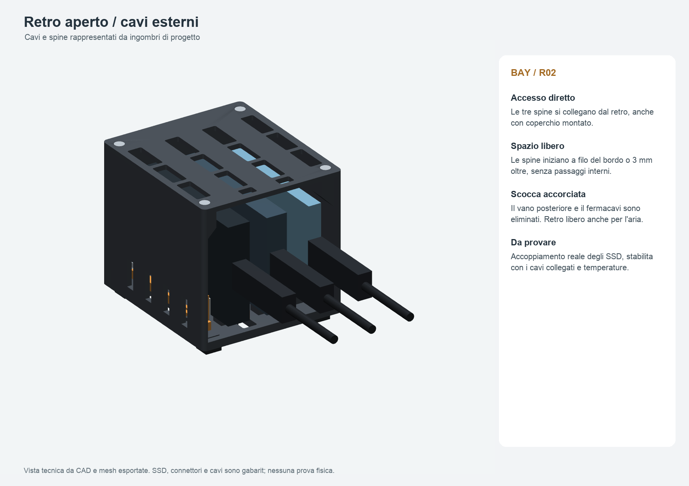
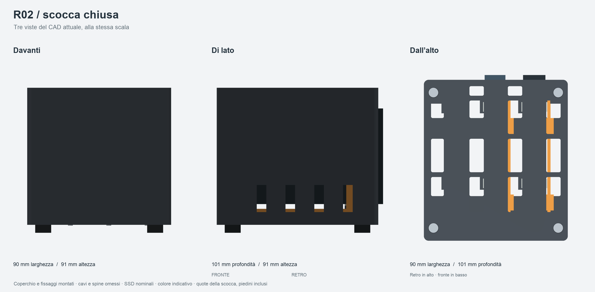

# Bay universale per tre SSD — R02, retro aperto

**Questa è la revisione da stampare.** La R01 con vano cavi è conservata nella cartella precedente; non mischiare scocca e coperchio delle due revisioni.

Tre sedi universali per Samsung T7, T7 Shield e T9, in verticale sul lato lungo. **Retro aperto, spine e cavi esterni.** La R02 elimina vano cavi, fermacavi, relativi fissaggi e lingua posteriore del coperchio.

Stato verificato in `verifiche/STATO_CONSEGNA.json`. Stampare prima il provino; accoppiamento e temperature reali richiedono prova fisica. Nessuna stampa avviata.





Le tre viste esterne sono ortogonali e alla stessa scala, con coperchio e fissaggi montati. Spine e cavi sono nascosti per valutare la scocca; gli SSD restano gabarit nominali e il colore è indicativo. Rigenerazione: `python sorgenti/viste_esterne.py`, nell’ambiente del progetto.

## Dimensioni e funzionamento

- **Scocca con coperchio e piedini: 90 × 101 × 91 mm**. Profondità ridotta di 115 mm rispetto ai 216 mm della R01, circa il 53%.
- Il T7 termina a filo del retro; Shield e T9 sporgono **3 mm**. Con i dischi, ingombro nominale senza cavi **90 × 104 × 91 mm**.
- Spine e cavi iniziano a filo del bordo posteriore o oltre. Nessun percorso, curva o raccolta dentro il bay. Collegamento dal retro anche con coperchio montato.
- Quattro viti svasate fissano il coperchio superiore, ora piatto e senza appendici posteriori.
- Passo sedi 24 mm, **10 mm fra le facce di due T9**, **11 mm fra facce esterne e pareti interne**.
- Appoggi a **8 mm dal fondo interno**, incluso silicone; **10 mm sopra il T9**; piedini da **5 mm**.
- Tamponi piccoli sulle zone di appoggio e guide laterali scorrevoli. La vite anteriore blocca la sponda senza spingere una punta contro il disco.

| Gabarit nominale | Fronte–retro | Altezza in sede | Spessore |
| --- | ---: | ---: | ---: |
| Samsung T7 | 85 mm | 57 mm | 8 mm |
| Samsung T7 Shield | 88 mm | 59 mm | 13 mm |
| Samsung T9 | 88 mm | 60 mm | 14 mm |

Dimensioni nominali dalla [scheda Samsung](https://download.semiconductor.samsung.com/resources/brochure/Samsung_Portable_SSD_Brochure.pdf), non rilevate al calibro. Gabarit rettangolari conservativi, senza riprodurre tutti i raccordi o la gomma. Custodie aggiuntive escluse.

La lunghezza rigida di circa 50 mm e il diametro cavo circa 5 mm, indicati dall'utente, sono mantenuti solo negli ingombri illustrativi esterni. La sezione provvisoria della spina è 9 × 16 mm. Non determinano più la profondità della scocca.

Il retro aperto espone i connettori e lascia i cavi liberi: sistemarli sulla scrivania senza tirare le porte o il bay. Non è un prodotto da trasportare carico o sollevare dal coperchio.

## Quote di accoppiamento

- Sponde con apertura fra tamponi circa **7,8–14,6 mm**. Posizione nominale pari allo spessore SSD + **0,2 mm totali**.
- Guide con **0,3 mm per lato** e **0,4 mm verticale**. Valori iniziali da verificare nel provino.
- Due appoggi inferiori 8 × 8 mm per disco. Sul T9 sostengono 8 dei 14 mm di spessore; il baricentro nominale cade dentro l'appoggio, senza implicare stabilità contro trazioni.
- Tasche M3: chiave 5,9 mm e altezza 2,8 mm, per dado standard chiave 5,5 mm e altezza circa 2,4 mm. Non usare dadi nyloc o inserti termici.
- La base conserva due piazzole posteriori piene da 10 × 10 mm sotto i piedini: non applicare silicone sopra prese aperte.

Base, fianchi inferiori e tetto rimangono ventilati. `verifiche/aria.json` misura sezioni geometriche campionate, non portata o temperature.

## File e quantità

| STL in `stampa/STL/` | Kit completo | Provino separato | Orientamento |
| --- | ---: | ---: | --- |
| `scocca_ventilata_R02.stl` | 1 | — | fondo sul piano |
| `coperchio_ventilato_R02.stl` | 1 | — | faccia esterna sul piano |
| `sponda_regolabile_R02.stl` | 3 | 1 aggiuntiva | piedi delle guide sul piano |
| `provino_sede_R02.stl` | — | 1 | fondo sul piano |

Controllare scala all'importazione: scocca **90 × 101 × 83 mm**, coperchio **90 × 101 × 3 mm**, provino **31 × 106 × 25 mm**. Il provino è più lungo della scocca perché riprende la sede di prova della R01; serve a provare appoggi e regolazione, non la forma del retro.

- `stampa/piatti_geometrici/`: 3MF con **sola geometria** in millimetri, senza profili.
- `stampa/progetti_ElegooSlicer/`: due veri progetti, **00 provino** e **01 kit completo**, con profili e percorsi quando convalidati nel report.
- `CAD/`: STEP dei singoli pezzi, versioni orientate per stampa e assieme con gabarit di SSD/cavi/ferramenta. L'assieme non va stampato.
- `sorgenti/`: sorgenti modificabili, parametri e dipendenze. `verifiche/mesh_assieme/` contiene mesh di controllo, non altri pezzi.

I colori delle anteprime distinguono i componenti. Ogni piatto usa un solo filamento; non occorrono cambi CANVAS o torre di spurgo.

## Componenti commerciali

| Componente | Quantità kit |
| --- | ---: |
| M3 × 10, testa cilindrica a brugola | 3 |
| M3 × 12, testa svasata DIN 7991 | 4 |
| Dado M3 standard, chiave 5,5 mm, altezza circa 2,4 mm | 7 |
| Rondella M3, esterno massimo 7 mm, spessore circa 0,5 mm | 3 |
| Piedino silicone adesivo 10 × 10 × 5 mm | 4 |
| Silicone adesivo 1 mm, 8 × 8 mm — appoggi | 6 |
| Silicone adesivo 1 mm, 6 × 10 mm — contatti laterali | 12 |
| Silicone adesivo 1 mm, 8 × 6 mm — battute anteriori | 3 |

Rispetto alla R01 eliminati cappello fermacavi, due M3 × 16, due dadi, due rondelle e sei rivestimenti da 0,5 mm.

Per conservare anche il provino assemblato: una M3 × 10, un dado, una rondella, sette tamponi come una sede e due strisce inferiori alte almeno 2 mm. Proteggono il piano dalla coda della vite. La sponda e il provino mantengono la geometria di accoppiamento della R01.

## Stampa e assemblaggio

Configurazione confermata dall'utente il 20 ottobre 2026: **ELEGOO Centauri Carbon 2 Combo, ugello 0,4 mm, PEI testurizzato, ELEGOO PETG PRO**. Profili in `slicer/`, provenienza in `verifiche/provenienza_profili.json`.

Impostazioni iniziali: **strato 0,20 mm, quattro pareti, 20% gyroid, brim esterno 5 mm, supporti disattivati**, stampa per strati. Scenario del profilo PETG PRO: **240 °C / PEI 65 °C**, portata massima **5 mm³/s**. Sono impostazioni preparate, non calibrazione fisica del pezzo.

Verificare scheda ed etichetta del filamento e umidità; la [pagina ELEGOO PETG PRO](https://eu.elegoo.com/products/petg-pro-filament-1-75mm-colored-1kg) indicava essiccazione a 60 °C per 8 ore nella consultazione di questa sessione. Usare attrezzatura adatta. Conservare il corretto profilo della Carbon 2 Combo.

I piatti includono margini e brim, evitando la zona esclusa 246–256 × 0–20 mm. Tempi e consumo effettivi dello scenario in `verifiche/slicing/riepilogo.json` e nel rapporto. Non cambiare gli orientamenti salvati.

1. Stampare prima il progetto **00 PROVINO**. Rimuovere brim, bave e piede d'elefante; montare sponda, dado, vite e rondella.
2. Applicare i sette tamponi e rialzare il provino. Provare separatamente i tre modelli scollegati, senza forzare la gomma o incurvare la sponda.
3. Se necessario correggere i parametri e rigenerare tutti i file; non scalare globalmente il modello.
4. Sul kit inserire i tre dadi delle regolazioni dal fondo; montare tre sponde con M3 × 10 e rondelle, inizialmente allentate.
5. Inserire i quattro dadi del coperchio dalle finestre interne, applicare i tamponi e i quattro piedini agli angoli. I posteriori vanno sulle piazzole piene.
6. Posare gli SSD, USB dietro, accostare delicatamente le sponde e bloccarne la posizione. Il coperchio resta a distanza dai dischi.
7. Montare quattro M3 × 12 svasate senza rondelle, con serraggio leggero. Le teste non devono forzare la plastica.
8. Collegare i tre cavi direttamente dall'esterno. Per estrarre un disco: scollegare il cavo, togliere il coperchio, allentare la sponda e sollevare.

## Verifiche e limiti

Gli export finali sono riaperti per controllare scala, quantità, corpi unici, normali, volume, facce degeneri/duplicate e screening delle autointersezioni. Il metodo triangolare esclude coppie con vertici condivisi; nessuna riparazione automatica.

Controlli aggiuntivi della R02: nessuno spinotto nel volume dell'enclosure, accesso diretto posteriore, appoggio di materiale attorno ai quattro fissaggi del coperchio, piazzole dei piedini e assenza di componenti interni per i cavi. Nove abbinamenti modello/slot e 27 assegnazioni nominali; estrazione a posizioni campionate, con cavi scollegati e coperchio rimosso.

Restano da provare fisicamente: misure reali di SSD e porte, silicone, scorrimento, serraggio, stabilità con i cavi collegati, creep e temperatura. Confrontare lo stesso SSD fuori/dentro il bay con ambiente e carico uguali; poi provare tre unità insieme almeno 60 minuti e fino a stabilizzazione. Registrare ambiente, temperatura disponibile dell'SSD, throughput e disconnessioni, con priorità al disco centrale. Usare volumi/file di prova senza sovrascrivere dati esistenti. Il CAD non dimostra assenza di throttling o resistenza meccanica.

## Rigenerazione

Python 3.11, versioni in `sorgenti/requirements.txt`. Tutte le quote in millimetri. Parametri principali in `sorgenti/parametri.json` e dettagli meccanici nelle funzioni CAD.

```bash
python3 -m venv .venv
.venv/bin/python -m pip install -r sorgenti/requirements.txt
.venv/bin/python -B sorgenti/genera.py
.venv/bin/python -B sorgenti/verifica.py
.venv/bin/python -B sorgenti/stampa.py --slice --slicer /percorso/ElegooSlicer.app/Contents/MacOS/ElegooSlicer
.venv/bin/python -B sorgenti/anteprime.py
.venv/bin/python -B sorgenti/revisiona_percorsi.py
```

Dopo la revisione visiva registrare gli hash dei progetti e delle tavole effettivamente viste in `verifiche/revisione_visiva.json`, poi eseguire `.venv/bin/python -B sorgenti/consegna.py`. Il comando controlla la coerenza e rigenera archivio e stato; non approva automaticamente tavole nuove. Nessuno script avvia la stampante.
