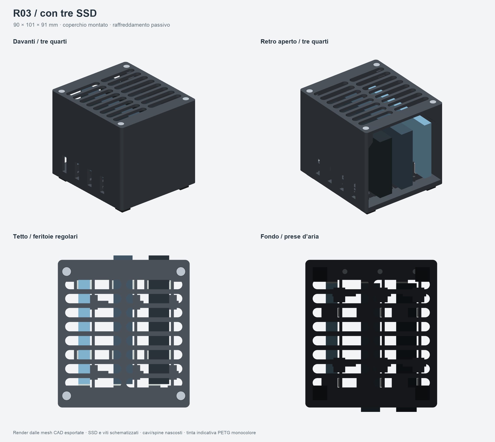
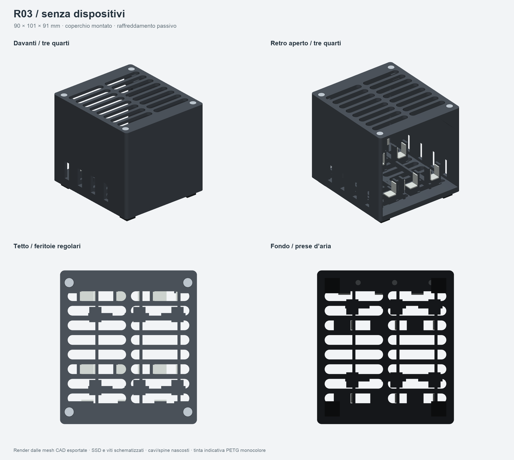
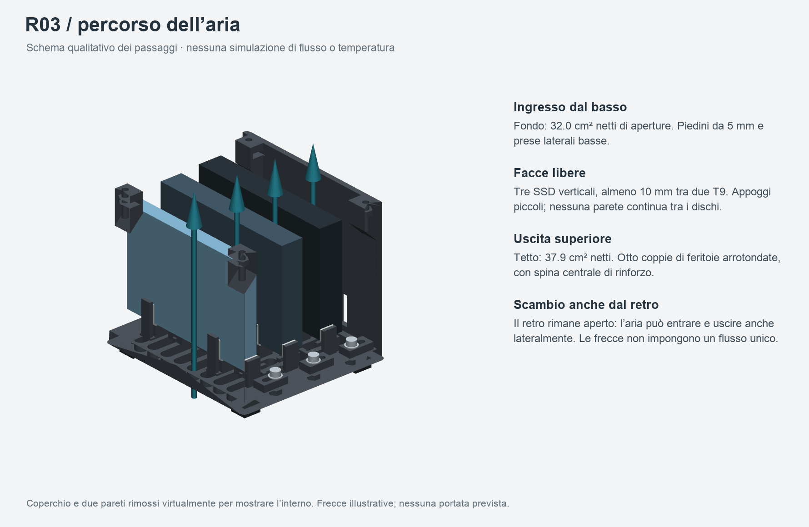

# Bay universale tre SSD — R03, ventilazione passiva

Revisione della R02 per uso ordinario e intermittente, con retro aperto, fondo ventilato e griglia superiore regolare. **Nessuna ventola; soltanto feritoie inferiori per lasciare aperta una futura integrazione.** Non sono stati progettati attacchi o adattatori per ventole.

**Stato finale nel file `verifiche/STATO_CONSEGNA.json`.** La preparazione di stampa riguarda un prototipo su quote nominali: accoppiamento, temperature, rigidità e stabilità richiedono prova fisica. Stampare prima il provino. Nessuna stampa avviata.







Le immagini vengono dalle mesh CAD esportate. Viti e SSD sono schematizzati; spine e cavi sono nascosti nelle tavole estetiche. Colore indicativo, parti rigide nello stesso PETG. Le frecce rappresentano passaggi possibili: non sono il risultato di una simulazione.

## Dimensioni e regolazione

- **90 × 101 × 91 mm**, piedini da 5 mm inclusi; ingombro nominale con SSD, senza cavi, **90 × 104 × 91 mm**.
- Tre sedi identiche; SSD verticali sul lato lungo, USB verso il retro.
- T7: 85 × 57 × 8 mm; T7 Shield: 88 × 59 × 13 mm; T9: 88 × 60 × 14 mm. Sono quote nominali dalla [scheda Samsung](https://download.semiconductor.samsung.com/resources/brochure/Samsung_Portable_SSD_Brochure.pdf), non misure al calibro.
- T7 a filo del retro, Shield e T9 sporgenti 3 mm. Spine e cavi rimangono esterni; tratto rigido dichiarato circa 50 mm e diametro cavo circa 5 mm sono soltanto ingombri illustrativi.
- Distanza fra due T9: 10 mm; distanza dalle pareti laterali interne: 11 mm. Aria sotto gli SSD: 8 mm; sopra il T9: 10 mm.
- Sponda scorrevole, due contatti laterali locali e due appoggi inferiori per disco. La vite anteriore blocca la sponda; non spinge una punta contro l'SSD.
- Apertura fra tamponi 7,8–14,6 mm; impostazione nominale spessore SSD + 0,2 mm totali. Il T7 ha 0,2 mm totali di gioco nominale, non 0,2 mm per lato.
- Guide: gioco di 0,3 mm per lato e 0,4 mm verticale. Silicone commerciale 1 mm. Verificare gioco reale e gomma del T9/Shield nel provino.

La R02 resta conservata separatamente. La R03 modifica fondo e tetto; non mescolare revisioni senza una verifica dell'assieme.

## Valutazione dell'aria e della struttura

**Il passivo è una scelta progettuale plausibile per l'uso intermittente descritto.** Le facce dei dischi rimangono libere, senza divisori continui, con ingressi inferiori/laterali, uscite superiori e un retro ampiamente aperto. La scocca PETG fa da supporto: non è progettata come dissipatore a contatto con gli SSD.

Fondo e tetto hanno otto file di due feritoie a capsula, **38,4 × 6,4 mm** ciascuna. Nervature trasversali e spina centrale: **3,2 mm**. La spina centrale divide la griglia in due banchi e riduce la luce delle aperture; passa sopra l'ingombro del disco centrale, lasciando liberi i canali fra gli SSD. Bordo laterale del tetto: 5 mm; tetto e pareti: 3 mm; fondo: 5 mm.

Le fondazioni di appoggi, guide, battute e tutti e quattro i piedini sono piene. Venti zone sono controllate volumetricamente sullo STEP esportato, inclusa la spina del coperchio. Quattro viti M3 su piazzole piene collegano il tetto alla scocca. Questo descrive la costruzione e l'assenza di vuoti sotto gli appoggi; non è una prova di resistenza.

| Misura geometrica netta | R02 | R03 |
| --- | ---: | ---: |
| Aperture del fondo | 17,5 cm² | 32,0 cm² |
| Aperture del tetto | 23,4 cm² | 37,9 cm² |
| Passaggio verticale continuo nei quattro corridoi, tre T9 | 12,1 cm² | 11,3 cm² |

Le prime due aree vengono dalle sezioni delle mesh finali, esclusi i fori vite e le fondazioni piene. La terza è una proiezione conservativa di **tutti** gli ostacoli lungo l'intera altezza, con tre T9, sponde, tamponi e ferramenta: individua linee verticali sempre libere. Non conta i percorsi con spostamenti laterali, possibili nei vani sotto/sopra i dischi e dal retro.

La R03 aumenta la superficie aperta ma riduce di circa il 7% il solo percorso perfettamente rettilineo rispetto alla R02; il disegno regolare e le fondazioni locali cambiano la distribuzione delle aperture. **Il vantaggio termico rispetto alla R02 resta da misurare:** area aperta e portata d'aria sono grandezze diverse.

Con circa 80 mm di altezza la spinta naturale è piccola. Per dare un ordine di grandezza, un canale ideale alto 80 mm con aria a 25 °C e differenza assunta di 10 K avrebbe circa **0,031 Pa** di spinta; a 5 e 20 K circa 0,016 e 0,062 Pa. Sono scenari di sensibilità, non temperature previste della bay. Nessuna portata, potenza dissipabile, CFD o simulazione di temperatura è stata calcolata.

La luce di 5 mm dalla scrivania offre circa 19,1 cm² lordi lungo il perimetro; l'accesso sotto la base può limitare lo scambio anche con un fondo molto aperto. Le prese laterali basse e il retro offrono percorsi aggiuntivi. Mantenere liberi fondo e tetto e confrontare il funzionamento nella posizione reale sulla scrivania.

Per la struttura, la zona presumibilmente più cedevole è la griglia del tetto. La spina centrale serve a sostenerla; non sono disponibili FEA, prove di carico, misura del creep o prova di stabilità con i cavi. Il coperchio è un elemento di chiusura, non una maniglia.

I principi di convezione naturale e la spinta di galleggiamento sono descritti da [COMSOL](https://www.comsol.com/blogs/introduction-to-modeling-natural-convection-in-comsol-multiphysics/); [nVent HOFFMAN](https://www.nvent.com/en-se/hoffman/products/encuav01) indica aperture alte e basse per il ricambio naturale. Questi riferimenti non convalidano le prestazioni del presente progetto.

I dati completi e il metodo riproducibile sono in `verifiche/valutazione_aria.json`. `verifiche/aria.json` conserva separatamente il controllo a sezioni campionate; il valore conservativo da usare è quello della tabella sopra.

## File, quantità e componenti commerciali

| STL in `stampa/STL/` | Kit | Provino separato | Orientamento |
| --- | ---: | ---: | --- |
| `scocca_ventilata_R03.stl` | 1 | — | fondo sul piano |
| `coperchio_ventilato_R03.stl` | 1 | — | faccia esterna sul piano |
| `sponda_regolabile_R03.stl` | 3 | 1 | piedi delle guide sul piano |
| `provino_sede_R03.stl` | — | 1 | fondo sul piano |

Scala in millimetri. Scocca 90 × 101 × 83 mm; tetto 90 × 101 × 3 mm; provino 31 × 106 × 25 mm. Il provino mantiene la sede regolabile delle revisioni precedenti; non riproduce l'intera griglia della R03.

- `stampa/progetti_ElegooSlicer/`: due veri progetti, 00 provino e 01 kit completo, con macchina, materiale, impostazioni e percorsi salvati.
- `stampa/piatti_geometrici/`: 3MF con sola geometria, millimetri e disposizione; privi di profili.
- `CAD/`: STEP singoli, STEP orientati per stampa e assieme con gabarit. L'assieme non va stampato.
- `verifiche/`: geometria, aria, percorsi e rassegna degli strati. `sorgenti/`: CAD parametrico e dipendenze.

| Componente commerciale | Quantità kit |
| --- | ---: |
| M3 × 10, testa cilindrica a brugola | 3 |
| M3 × 12, testa svasata DIN 7991 | 4 |
| Dado M3 standard, chiave 5,5 mm, altezza circa 2,4 mm | 7 |
| Rondella M3, esterno massimo 7 mm, spessore circa 0,5 mm | 3 |
| Piedino silicone adesivo 10 × 10 × 5 mm | 4 |
| Silicone adesivo 1 mm, 8 × 8 mm — appoggi | 6 |
| Silicone adesivo 1 mm, 6 × 10 mm — contatti laterali | 12 |
| Silicone adesivo 1 mm, 8 × 6 mm — battute anteriori | 3 |

Per conservare il provino assemblato: una M3 × 10, un dado M3, una rondella, sette tamponi come una sede e due rialzi inferiori alti almeno 2 mm, per lasciare libera la coda della vite.

## Stampa e assemblaggio

Configurazione confermata dall'utente il 20 ottobre 2026: **ELEGOO Centauri Carbon 2 Combo, ugello 0,4 mm, piano PEI testurizzato, ELEGOO PETG PRO**. Profili in `slicer/`, derivati dalla R02 della stessa sessione. Un solo filamento per piatto; nessun cambio CANVAS o torre di spurgo.

Profilo preparato: **strati 0,20 mm, quattro pareti, 20% gyroid, brim esterno 5 mm, supporti disattivati**, stampa per strati. Scenario PETG PRO **240 °C, piano 65 °C, portata massima 5 mm³/s**. Lo slicing verifica i percorsi con queste impostazioni; calibrazione, adesione e comportamento effettivo del filamento richiedono stampa. Controllare etichetta/scheda del lotto e umidità prima della prova.

I piatti rispettano il volume e la zona esclusa del profilo ECC2, incluso il brim. Stime di tempo e consumo realmente restituite da ElegooSlicer in `verifiche/RAPPORTO_VERIFICHE.md`. Le stime includono il brim; non includono una ventola o una stampa multicolore.

1. Stampare prima il piatto **00 PROVINO**. Togliere brim e bave, controllare il piede d'elefante, montare dado, sponda, vite e rondella.
2. Applicare i sette tamponi, rialzare il provino e provare separatamente T7, Shield e T9 scollegati. Non forzare la gomma. Correggere parametri e rigenerare se il gioco reale non è adatto; non scalare globalmente il modello.
3. Nel kit inserire i tre dadi delle regolazioni dal fondo e montare le tre sponde con M3 × 10 e rondelle, inizialmente allentate.
4. Inserire i quattro dadi del tetto dalle finestre interne. Applicare silicone e quattro piedini sulle piazzole piene, senza coprire le prese.
5. Posare i dischi, USB dietro; accostare delicatamente le sponde e bloccarle in posizione. Il tetto rimane a distanza dai dischi.
6. Montare il tetto con quattro M3 × 12 svasate, senza rondelle e con serraggio leggero.
7. Collegare i cavi dal retro. Per estrarre: scollegare il cavo, togliere il tetto, allentare la sponda e sollevare.

## Prove ancora necessarie

Prima del kit verificare tutti i nove abbinamenti modello/slot, stabilità del T7, corsa delle sponde, viti, silicone e rimozione. I controlli digitali coprono gabarit nominali e posizioni campionate, non tolleranze dei dispositivi reali.

Per valutare il passivo, confrontare lo stesso SSD libero e nel bay, nello stesso orientamento, ambiente e carico:

1. Collegato inattivo per 30 minuti.
2. Uso intermittente rappresentativo del lavoro normale.
3. Trasferimento sostenuto per almeno 60 minuti e fino alla stabilizzazione.
4. Ripetere con uno, due e tre SSD; dare priorità al T9 nello slot centrale, con coperchio montato.

Registrare ambiente, temperatura interna se leggibile, temperatura superficiale, velocità e disconnessioni. Sensore interno, superficie e temperatura ambiente ammessa dal produttore sono grandezze diverse. Usare file/volumi di prova senza sovrascrivere dati esistenti. Se il bay aumenta sensibilmente la temperatura o anticipa un calo persistente di prestazioni rispetto alla prova libera, rivedere aperture/distanze prima di considerare riuscito il passivo.

## Verifiche e riproduzione

STL e STEP finali riaperti: scala, corpi, mesh chiuse, normali, volume positivo, facce degeneri/duplicate e screening delle autointersezioni. Il metodo triangolare esclude coppie con vertici condivisi. Nessuna riparazione automatica della mesh. Verificati nove abbinamenti e 27 assegnazioni nominali, estrazione a quote campionate, accesso utensile e supporto dei fissaggi.

3MF geometrici e nativi riaperti e controllati con unità, quantità e trasformazioni. I percorsi reali sono esaminati nelle tavole di tutti gli strati e in dettagli delle zone critiche. La relativa approvazione è legata agli hash del progetto e delle immagini; generare tavole non equivale ad averle esaminate.

Python 3.11, versioni fissate in `sorgenti/requirements.txt`. Tutte le quote sono in mm.

```bash
python3 -m venv .venv
.venv/bin/python -m pip install -r sorgenti/requirements.txt
.venv/bin/python sorgenti/genera.py
.venv/bin/python sorgenti/verifica.py
.venv/bin/python sorgenti/valuta_aria.py
.venv/bin/python sorgenti/stampa.py --slice --slicer /percorso/ElegooSlicer.app/Contents/MacOS/ElegooSlicer
.venv/bin/python sorgenti/anteprime.py
.venv/bin/python sorgenti/viste_esterne.py
.venv/bin/python sorgenti/render_studio.py
.venv/bin/python sorgenti/revisiona_percorsi.py
```

Se la cartella R02 è presente accanto alla R03, il confronto geometrico viene ricalcolato. Altrimenti viene usato il riferimento R02 salvato in `verifiche/r02_riferimento_aria.json`; la geometria e i passaggi della R03 vengono sempre ricalcolati sui propri export.

Dopo l'ispezione delle tavole registrare gli hash effettivamente esaminati in `verifiche/revisione_visiva.json`, poi eseguire `.venv/bin/python sorgenti/consegna.py` per ricontrollare la coerenza e rigenerare archivio e stato. Nessuno script avvia la stampante.
