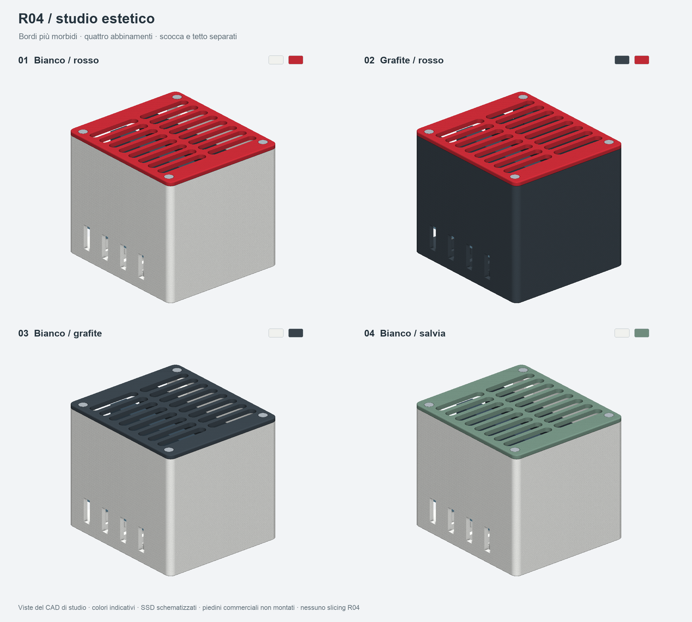
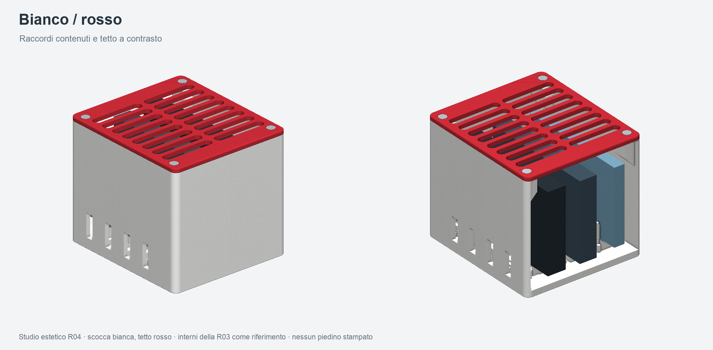
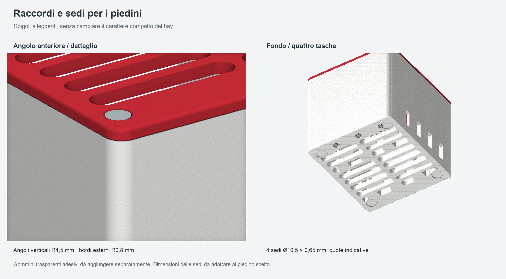

# R04 — studio estetico del bay SSD

Studio di forma e colore richiesto dopo la R03. Serve a valutare l'aspetto esterno, con quote modificabili e render dal CAD. Non e una nuova preparazione di stampa: non sono presenti STL, piatti, profili, G-code o slicing della R04. La R03 rimane la revisione preparata per la stampa del prototipo nominale.







## Interventi estetici

- Angoli verticali esterni raccordati a R4,5 mm, rispetto ai R3 mm della R03.
- Bordo superiore del tetto e bordo inferiore della scocca con raccordo R0,8 mm; bordo inferiore del tetto R0,4 mm.
- Scocca e tetto separati per abbinamenti a due colori: bianco/rosso, grafite/rosso, bianco/grafite, bianco/salvia. I colori sono indicativi; non rappresentano filamenti gia disponibili o una resa fisica verificata.
- Quattro sedi tonde sul fondo per gommini adesivi trasparenti commerciali. Le sedi sono ricavate nel corpo; nessun piedino rigido e previsto tra i pezzi da stampare. Nei render i piedini commerciali non sono montati.

I colori dei due pezzi possono essere scelti separatamente. Il presente studio non richiede una suddivisione multicolore della stessa parete o la scelta di un processo CANVAS.

## Sedi dei piedini

Nella R03 erano presenti quattro piazzole piane per piedini adesivi 10 x 10 x 5 mm. Lo studio R04 propone invece quattro tasche tonde: diametro **10,5 mm**, profondita **0,65 mm**, con centri XY a (10,10), (80,10), (10,91), (80,91) mm. Sotto ogni sede e conservata una piazzola piena di diametro 12 mm.

Diametro, forma e profondita sono provvisori: l'utente non ha ancora indicato il gommino commerciale. Lo studio ipotizza un piedino tondo da circa 10 mm; non e una verifica di accoppiamento. Nella revisione di stampa andranno adattati al prodotto scelto. Il rialzo utile sara l'altezza del gommino meno la profondita della sede; conservare la luce dalla scrivania richiesta per l'aria, originariamente 5 mm.

Il corpo nudo, tetto incluso, mantiene un ingombro 90 x 101 x 86 mm. L'altezza finale con i gommini dipendera dalla loro scelta.

## File e controlli dello studio

`CAD_studio/` contiene STEP separati di scocca e tetto, esportati e riaperti: un solido valido per ciascun pezzo. Le mesh usate nei render sono chiuse, con volume positivo e normali coerenti; nessuna faccia degenere o duplicata. Gli arrotondamenti sono geometria CAD effettiva. L'occlusione ambientale e la luce sono effetti di visualizzazione; la superficie mostrata non e una prova di finitura stampata.

`sorgenti/parametri_estetici.json` conserva quote e palette. `sorgenti/riferimento_r03/` conserva i due STEP di partenza e gli ingombri dei componenti interni; i relativi hash sono in `verifiche/riferimento_r03.json`. Gli SSD e le viti restano schematizzati. Spine e cavi sono nascosti nelle viste.

Non sono stati eseguiti nuovi controlli di interferenza, verifica degli spessori minimi dopo i raccordi, screening delle autointersezioni, prove di assemblaggio, resistenza, dissipazione o slicing. Le verifiche della R03 non si trasferiscono automaticamente alla R04. Il passo successivo, una volta scelta la direzione estetica, sara integrare i dettagli nella revisione da stampare.

## Riproduzione

Python 3.11; dipendenze in `sorgenti/requirements.txt`. Dalla cartella del progetto:

```bash
python3 -m venv .venv
.venv/bin/python -m pip install -r sorgenti/requirements.txt
.venv/bin/python sorgenti/studio_estetico.py
```

Il comando ricrea i due STEP di studio, i render e `verifiche/stato_studio.json`. Non prepara o avvia una stampa.
