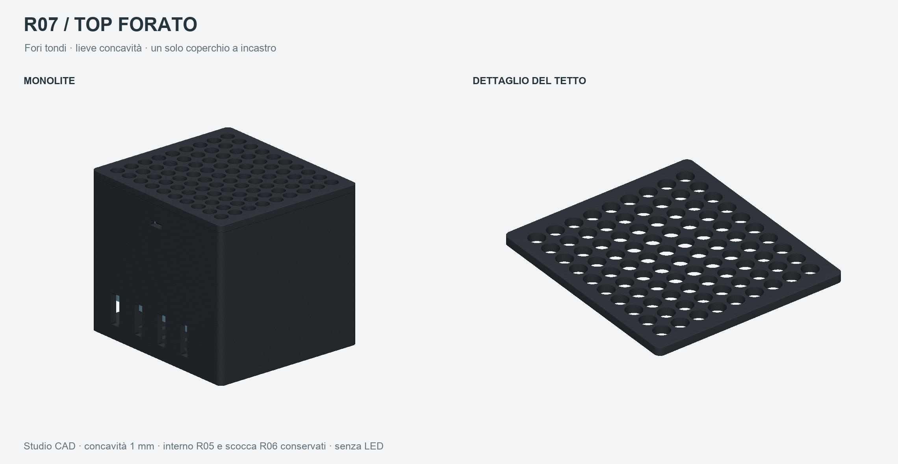

# R07 — studio del tetto forato e lievemente concavo

Studio di fattibilità richiesto il 20 ottobre 2026 a partire dalla fotografia allegata. Scocca monolite R06 e interno semplice R05 conservati. Cambia soltanto il coperchio: **90 fori tondi Ø7,35 mm**, passo 9 mm e concavità centrale di **1 mm**. Tutto grafite, senza LED, parti colorate aggiunte o ventola.



Il coperchio resta **un solo pezzo**, con gli stessi due agganci laterali e gli stessi riscontri anteriori. Nessuna vite, ferramenta o parte di assemblaggio aggiuntiva. La faccia inferiore della piastra resta alla quota R06 di 83 mm; lo spessore è almeno 3 mm. Per ottenere la concavità senza assottigliare il centro, il bordo arriva a quota 87 mm: altezza esterna complessiva maggiore di 1 mm rispetto alla R06. Gommini esclusi.

La superficie curva si raccorda al piano del bordo senza uno scalino. I ponticelli fra i fori misurano nominalmente 1,65 mm; la loro resa con ugello 0,4 mm richiede una prova. SSD e colori nei render sono schematici; il dettaglio del tetto mostra solo la piastra, con gli agganci nascosti virtualmente sotto il piano inferiore.

## Aria

La somma delle sezioni dei fori è **38,19 cm²**, contro circa **37,91 cm²** del tetto R06. Il confronto riguarda l'area geometrica, non dimostra portata o prestazioni termiche equivalenti: cambiano numero e forma dei passaggi. Fondo, aperture laterali e spazi fra gli SSD restano quelli della R06. Nessuna CFD o prova termica.

## Costo della concavità nella stampa

Due prove reali di slicing in **ElegooSlicer 2.4.2**, con i profili della R06 per Centauri Carbon 2 Combo, ugello 0,4 mm, PEI testurizzato ed ELEGOO PETG PRO. Supporti automatici dal piano attivati per queste prove. I risultati sono preliminari:

| Orientamento | Strati | Supporti | Stima filamento | Stima tempo |
| --- | ---: | --- | ---: | --- |
| Faccia concava verso il piano | 80 | Nei primi quattro strati, Z 0,2–0,8 mm | 23,22 g | 1 h 55 min 37 s |
| Appoggiato sul bordo anteriore | 505 | Fino a Z 46,4 mm | 25,69 g | 2 h 18 min 27 s |

Per la prima prova conviene valutare la faccia concava verso il basso: supporti bassi accessibili dall'esterno. Il contatto dei supporti può lasciare segni sulla faccia superiore; facilità di rimozione e finitura non sono state provate. Non si può trasferire il vecchio piatto R06 del tetto senza rifare lo slicing. La stampa sul bordo richiede supporti più alti e non è stata sottoposta a revisione visiva completa.

Le prove non hanno prodotto avvisi dello slicer o candidati di nuove isole esterne nello screening raster. Sono stati osservati la tavola completa degli 80 strati della prima variante e l'ingrandimento dei primi sei strati. Non costituisce una revisione completa della stampa: dettagli finali degli agganci e finitura richiedono ancora verifica. I segmenti di supporto possono essere indicati dallo slicer come interfaccia e hanno colori diversi nelle tavole.

## Stato e file

**Studio estetico e di fattibilità, non pronto per la stampa.** La consegna completa da stampare rimane `bay-ssd-universale-r06-monolite/BAY_SSD_R06_CONSEGNA.zip`. Non è stata avviata alcuna stampa. I progetti in `verifiche/slicing_prova/` sono esplicitamente prove non approvate.

Il STEP del coperchio è esportato e riaperto: solido valido, un corpo; mesh chiusa, normali coerenti, volume positivo, senza facce degeneri o duplicate. Screening delle autointersezioni senza coppie rilevate, con esclusione dei triangoli con vertici condivisi. Controllate le interferenze statiche con scocca e tre gabarit SSD; nessuna rilevata. L'incastro non è stato provato fisicamente.

Sorgenti in `sorgenti/`, quote in millimetri e dipendenze in `sorgenti/requirements.txt`. Il modello si rigenera con Python 3.11:

```sh
python sorgenti/studio.py
python sorgenti/prova_slicing.py
```

Lo script di studio usa i dati dell'area R06 dalla cartella sorella per il confronto; la geometria è generata dai propri sorgenti. La prova di slicing usa il percorso locale di ElegooSlicer riportato nel sorgente. Il render usa VTK e Arial di macOS.
