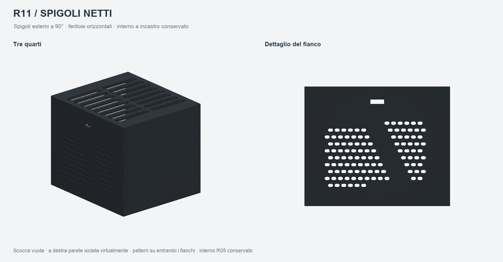
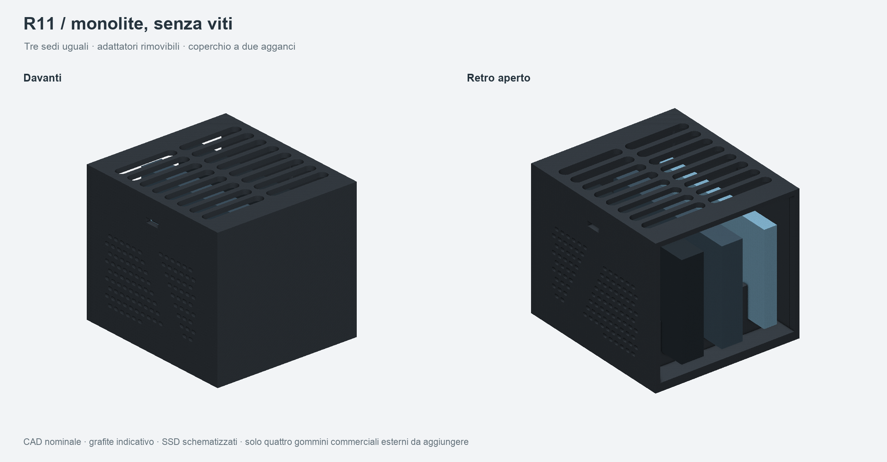
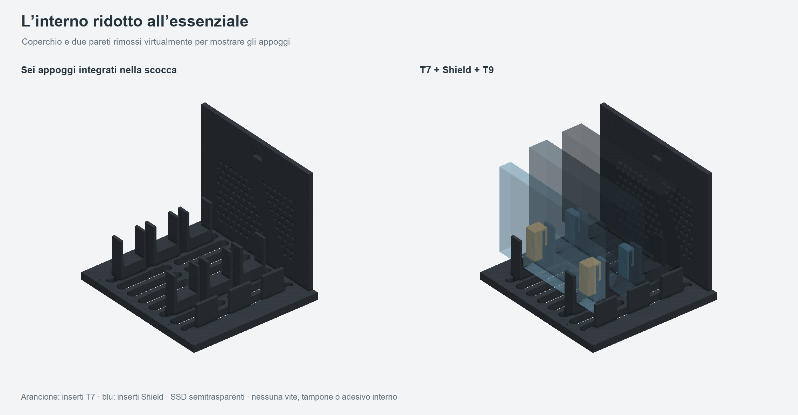
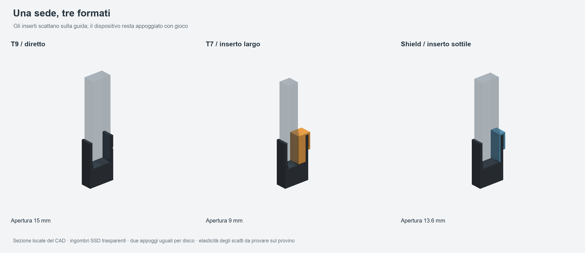
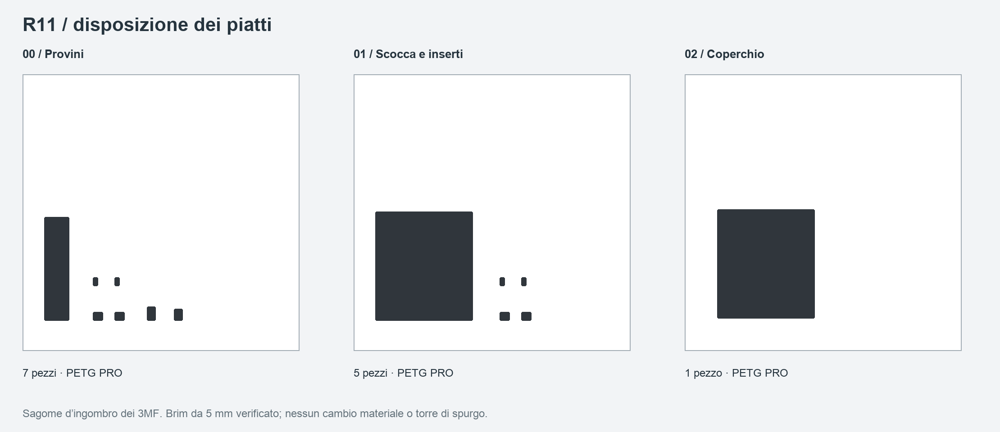

# Bay tre SSD — R11 — spigoli netti

**Revisione da stampare: R11 — spigoli esterni netti. Pronto per la stampa del prototipo nominale, iniziando dai provini.** Ingombri del monolite e interno semplice R05 conservati. La R11 elimina i raccordi esterni di scocca e tetto: spigoli a 90° sui fianchi e bordo del tetto squadrato. Il tetto conserva le feritoie orizzontali della R06; i fianchi adottano due campi di piccole feritoie orizzontali sfalsate separati da una fascia diagonale piena, ispirati ai riferimenti inviati. Non riprende bombature, elementi in legno o porte dei prodotti fotografati. Tre sedi uguali e due appoggi bassi per ogni SSD. Il T9 entra direttamente; T7 e T7 Shield usano una coppia di piccoli inserti. Gli inserti si agganciano alle guide, mentre gli SSD restano appoggiati con gioco. Coperchio rimovibile con due agganci laterali.

**Zero viti, dadi, rondelle, silicone o adesivi interni.** Il kit contiene sei pezzi stampati. Gli unici componenti commerciali previsti sono quattro gommini adesivi trasparenti esterni, da scegliere.

Stato e riscontri finali in `verifiche/STATO_CONSEGNA.json` e `verifiche/RAPPORTO_VERIFICHE.md`. Prima della scocca completa stampare il piatto 00: la forza e l'elasticità degli incastri richiedono una prova fisica. Nessuna stampa è stata avviata.









## Funzionamento

| SSD | Apertura utile | Gioco totale nominale sullo spessore | Inserti per disco |
| --- | ---: | ---: | ---: |
| T9, spessore 14 mm | 15 mm | 1 mm | Nessuno |
| T7, spessore 8 mm | 9 mm | 1 mm | 2 larghi |
| T7 Shield, spessore 13 mm | 13,6 mm | 0,6 mm | 2 sottili |

I giochi sono totali: per esempio il T9 ha nominalmente 0,5 mm per lato quando centrato. Le tre sedi sono identiche; la coppia di inserti può essere spostata in qualunque slot. La dotazione del kit corrisponde ai tre dispositivi dell'utente, uno per modello. Per più SSD dello stesso modello stampare una coppia di inserti per ciascun T7 o Shield.

Gli appoggi sono integrati nella scocca, non sono pezzi da montare. Le guide salgono di 18 mm sopra il piano su cui posa il disco. Gli inserti modificano soltanto lo spazio laterale e si applicano dall'alto sulla guida destra. L'incastro trattiene l'inserto, non comprime l'SSD. Nessun precarico elastico sul dispositivo.

Il coperchio si appoggia sulla scocca ed è trattenuto da due linguette con piccoli risalti e relative finestrelle laterali. Due riscontri anteriori aiutano l'allineamento. Per aprire, alleggerire l'aggancio premendo delicatamente le linguette verso l'interno e sollevare il tetto.

Il retro resta aperto per i collegamenti. L'alloggiamento serve per uso fermo sulla scrivania; non realizza un bloccaggio da trasporto o da urto. I cavi non sono trattenuti dal bay e non devono trascinarlo.

## Ingombro ed estetica

- Scocca con tetto, senza gommini: **90 × 101 × 86 mm**.
- Con T9/Shield nominali, senza spine, cavi o gommini: **90 × 104 × 86 mm**.
- I gommini aumentano l'altezza in funzione del prodotto scelto e dell'incasso.
- Spigoli esterni di scocca e coperchio a 90°, con raggio nominale zero: rimossi R3 mm sugli angoli verticali e i piccoli raccordi da 0,4/0,2 mm sui bordi esterni. Restano i piccoli raccordi funzionali interni già presenti. Pareti 3 mm, fondo 5 mm e tetto 3 mm.
- Fronte pieno, tetto piatto tono su tono e feritoie orizzontali in due banchi, otto coppie arrotondate, con spina centrale. Foratura del coperchio e agganci identici alla R10; il suo perimetro esterno è ora squadrato.
- Pattern su entrambi i fianchi: **108 feritoie per lato**, orizzontali arrotondate **3,4 × 2,2 mm**, disposte in righe orizzontali sfalsate. Fascia diagonale piena nominale **8 mm**, cornice integra e zona degli agganci libera. Quattro aperture laterali grandi della R06 sostituite dal nuovo motivo. Nessuna vite.
- Grafite uniforme per scocca, tetto e inserti, come nello studio approvato. Il colore del render è indicativo; usare il PETG PRO scuro disponibile per tutti i piatti. Gli inserti arancioni/blu e gli SSD trasparenti nelle viste interne servono a spiegare l'assieme.

Le dimensioni SSD sono nominali: T7 85 × 57 × 8 mm; Shield 88 × 59 × 13 mm; T9 88 × 60 × 14 mm. Non sono state rilevate al calibro. Gli ingombri sono semplificati e non riproducono gomma, raccordi e posizione esatta delle porte.

## Aria e piedini

Restano 8 mm sotto il disco, 10 mm sopra il T9 e 10 mm fra le facce di due T9. Le guide occupano due zone corte lungo ciascun disco. Non ci sono divisori continui fra gli SSD.

Misure geometriche sulle mesh esportate: fondo circa **30,2 cm²**, tetto circa **37,9 cm²**. I quattro corridoi verticali conservativi, con tre T9, conservano circa **15,2 cm²** di passaggio sempre libero. Le nuove aperture laterali offrono circa **6,96 cm² netti per fianco**, misurati sulla mesh, oltre al fondo e al tetto. Sono aree, non portate o prestazioni termiche. Nessuna ventola o attacco ventola progettato; il fondo rimane forato.

Quattro sedi inferiori tonde **Ø10,5 × 0,65 mm**, su piazzole piene Ø12 mm, riprendono lo studio R04. Sono quote provvisorie per gommini adesivi trasparenti commerciali: adattarle al prodotto scelto. I gommini non sono pezzi stampati e non sono montati nei render.

L'obiettivo di luce utile dalla scrivania rimane 5 mm. Il rialzo effettivo è l'altezza del gommino meno 0,65 mm di incasso. Per conservare 5 mm utili serve quindi un gommino alto almeno circa 5,65 mm, oppure una modifica delle sedi dopo aver scelto i piedini. Non è ancora una compatibilità verificata con un prodotto commerciale.

## STL e quantità

| File in `stampa/STL/` | Quantità kit | Orientamento già salvato |
| --- | ---: | --- |
| `scocca_R11.stl` | 1 | Fondo sul piano |
| `coperchio_R11.stl` | 1 | Faccia esterna del tetto sul piano, linguette verso l'alto |
| `inserto_T7_R11.stl` | 2 | Cappello sul piano, gambette verso l'alto |
| `inserto_Shield_R11.stl` | 2 | Cappello sul piano, gambette verso l'alto |

Il kit è composto da **sei pezzi**. Per il piatto 00 sono inclusi separatamente:

| Provino | Quantità | Scopo |
| --- | ---: | --- |
| `provino_sede_R11.stl` | 1 | Provare i tre SSD nei due appoggi e gli inserti |
| `provino_chiusura_femmina_R11.stl` | 1 | Piccola parete con la finestra di aggancio |
| `provino_chiusura_maschio_R11.stl` | 1 | Linguetta del coperchio su una piccola piastra |
| Inserti T7 e Shield, stessi STL del kit | 2 + 2 | Provare la coppia per ogni modello |

Il provino della sede ha due bordi longitudinali per rimanere un pezzo unico dopo la foratura del fondo. I provini di chiusura riprendono le geometrie di accoppiamento del coperchio e della parete.

`CAD/` contiene STEP dei singoli pezzi, versioni orientate per la stampa e un assieme con tre gabarit SSD. L'assieme completo non va stampato. `stampa/piatti_geometrici/` contiene 3MF con sola geometria e disposizione, in millimetri; `stampa/progetti_ElegooSlicer/` contiene i veri progetti con profili, impostazioni e percorsi.

## Stampa

Configurazione confermata nella sessione: **ELEGOO Centauri Carbon 2 Combo, ugello 0,4 mm, PEI testurizzato, ELEGOO PETG PRO**. Impostazioni numeriche conservate dalla R10 e nuovamente sottoposte a slicing per la R11; provenienza in `verifiche/provenienza_profili.json`. Materiale scelto fra quelli disponibili per i componenti funzionali, senza aggiungere gomma o altri materiali agli interni.

Impostazioni preparate: **strati 0,20 mm, quattro pareti, 20% gyroid, brim esterno 5 mm, supporti disattivati, stampa per strati**. Scenario PETG PRO: **240 °C, piano 65 °C, portata massima 5 mm³/s**. Sono impostazioni dello slicing verificato, non una calibrazione fisica di questi incastri. Filamento, umidità e adesione vanno controllati prima della prova; usare la scheda del lotto.

Tre piatti salvati:

1. **00 PROVINO PRIMA DI TUTTO**: sede, quattro inserti e due parti del provino di chiusura.
2. **01 SCOCCA INSERTI**: scocca e quattro inserti. Un solo colore/materiale.
3. **02 COPERCHIO**: tetto capovolto, un solo colore/materiale. Usare lo stesso PETG PRO scuro della scocca per mantenere il monolite uniforme.



Le chiusure superiori delle feritoie laterali e le bave residue richiedono controllo sulla prima stampa; l’anteprima non dimostra la finitura reale.

I progetti conservano il profilo PETG PRO confermato; i colori reali disponibili non sono stati confermati e le palette delle immagini non li certificano. Non sono richiesti cambi CANVAS, torre di spurgo o combinazioni di materiali. Il brim e la zona esclusa della macchina sono inclusi nei controlli. Non ruotare o scalare globalmente i pezzi per correggere un incastro.

Le stime di ElegooSlicer, includendo il brim, sono **131,57 g e 7 h 38 min 24 s per il kit**, più **15,63 g e 1 h 11 min 19 s per i provini**. Dettagli in `verifiche/RAPPORTO_VERIFICHE.md` e `verifiche/slicing/riepilogo.json`. Sono stime dello slicer, non tempi o consumi misurati su una stampa fisica.

## Prima prova e montaggio

1. Stampare il piatto 00. Rimuovere brim, bave e fili, pulendo con particolare cura le superfici che toccano gli SSD e i piccoli risalti degli agganci.
2. Provare il T9 direttamente nel provino. Deve posarsi dall'alto, appoggiare su entrambi i sostegni e rimanere verticale con un po' di gioco.
3. Agganciare due inserti T7 alle guide destre; provare il T7. Sostituirli con i due inserti sottili e provare lo Shield. Non forzare gli SSD o la loro gomma.
4. Provare separatamente le due parti del provino del coperchio. Verificare che lo scatto entri e si liberi con le dita, senza pieghe permanenti o segni evidenti. Ripetere alcune aperture.
5. Se gli scatti sono troppo duri o laschi, correggere i giochi/risalti e rigenerare il progetto prima del kit. Le prove statiche digitali non misurano la forza o la durata degli incastri.
6. Stampare il kit, applicare i gommini nelle sedi e montare gli inserti necessari. Posare gli SSD con USB verso il retro; inserire il tetto e accompagnare i due agganci.
7. Collegare i cavi dall'esterno e verificare che non inclinino i dischi o trascinino il bay. Per estrarre: scollegare i cavi, aprire il tetto e sollevare il dispositivo. Gli inserti possono restare nella sede.

## Verifiche e limiti

Gli STL e gli STEP finali sono riaperti, con controllo di scala, quantità, corpo unico, normali, volume, facce degeneri/duplicate e screening delle autointersezioni. Lo screening esclude triangoli con vertici condivisi; non sostituisce ogni possibile analisi geometrica. Nessuna riparazione automatica della mesh.

Verificati nove abbinamenti modello/slot e tutte le 27 assegnazioni nominali. Nessuna collisione statica fra scocca, coperchio, inserti e gabarit. L'estrazione è controllata a quote campionate, con tetto e cavi rimossi. Gli incastri del coperchio e degli inserti sono controllati nella posizione montata: la loro deformazione durante il montaggio, la forza e la fatica non sono validate.

I 3MF geometrici e nativi sono riaperti e controllati in millimetri, con quantità, trasformazioni e ingombri dei pezzi. Tutti gli strati sono esaminati nelle tavole e le zone critiche a campione negli ingrandimenti. La revisione è registrata sugli hash dei file realmente esaminati.

Restano da provare fisicamente accoppiamento, elasticità, superfici di contatto, stabilità e gommini. Per il passivo confrontare lo stesso SSD libero e nel bay, nello stesso ambiente e orientamento, prima in inattività e uso intermittente, poi con trasferimenti sostenuti. Provare anche i tre SSD insieme per almeno 60 minuti e fino a stabilizzazione, con attenzione al T9 centrale. Registrare temperatura ambiente, sensore SSD se disponibile, superficie, velocità e disconnessioni. Usare dati di prova senza sovrascrivere quelli esistenti. Nessuna temperatura, potenza dissipabile o assenza di throttling è dimostrata dal CAD.

## Rigenerazione

Python 3.11; dipendenze fissate in `sorgenti/requirements.txt`. Quote in millimetri. Parametri principali in `sorgenti/parametri.json`; profili e dettagli degli agganci nelle funzioni CAD.

```bash
python3 -m venv .venv
.venv/bin/python -m pip install -r sorgenti/requirements.txt
.venv/bin/python sorgenti/genera.py
.venv/bin/python sorgenti/verifica.py
.venv/bin/python sorgenti/confronta_revisioni.py  # facoltativo: richiede la cartella R10
.venv/bin/python sorgenti/stampa.py --slice --slicer /percorso/ElegooSlicer.app/Contents/MacOS/ElegooSlicer
.venv/bin/python sorgenti/anteprime.py
.venv/bin/python sorgenti/revisiona_percorsi.py
```

Dopo aver ispezionato le tavole, registrare la revisione e gli hash in `verifiche/revisione_visiva.json`, quindi eseguire `.venv/bin/python sorgenti/consegna.py`. Il controllo finale aggiorna stato e archivio; non approva automaticamente nuove tavole. Nessuno script avvia la stampante.

## Provenienza e conservazione delle revisioni

Il confronto sui STEP finali in `verifiche/confronto_revisioni.json` verifica la conservazione di sedi, inserti, provini, forature e agganci rispetto alla R10. Il coperchio conserva la stessa griglia e gli stessi agganci, con perimetro esterno ora a spigolo. Le modifiche rispetto alla R10 sono limitate ai raccordi esterni, azzerati; ingombri, perforazioni e interno rimangono identici. R10 e tutte le revisioni precedenti restano conservate. Le singole capsule laterali rimangono orizzontali, con file a quota costante e fascia diagonale piena. La R08 con fori tondi sul tetto non è stata consegnata ed è superata da questa richiesta. I sorgenti R11 generano autonomamente tutti i modelli; soltanto lo script facoltativo di confronto richiede la cartella sorella R10 per ripetere l’audit di provenienza.

Le temperature iniziali di 240 °C e 65 °C rientrano nelle indicazioni pubblicate da [ELEGOO per PETG PRO](https://www.elegoo.com/products/petg-pro-filament-1-75mm-colored-1kg), consultate il 20 ottobre 2026; il materiale reale e gli incastri restano da provare. Il manuale [Centauri Carbon 2 Combo, versione inglese V1.3](https://elegoo-downloads.oss-us-west-1.aliyuncs.com/tutorials/Centauri%20Carbon%202%20Combo/Centauri%20Carbon%202%20Combo%20User%20Manual-English-V1.3.pdf) identifica nello slicer il modello «Elegoo Centauri Carbon 2» e l’ugello 0,4 mm.
