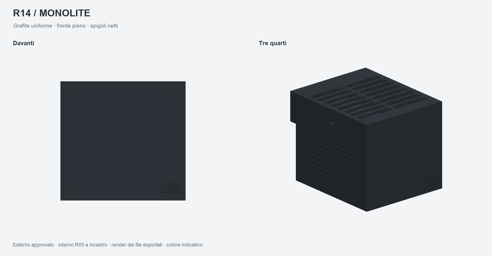
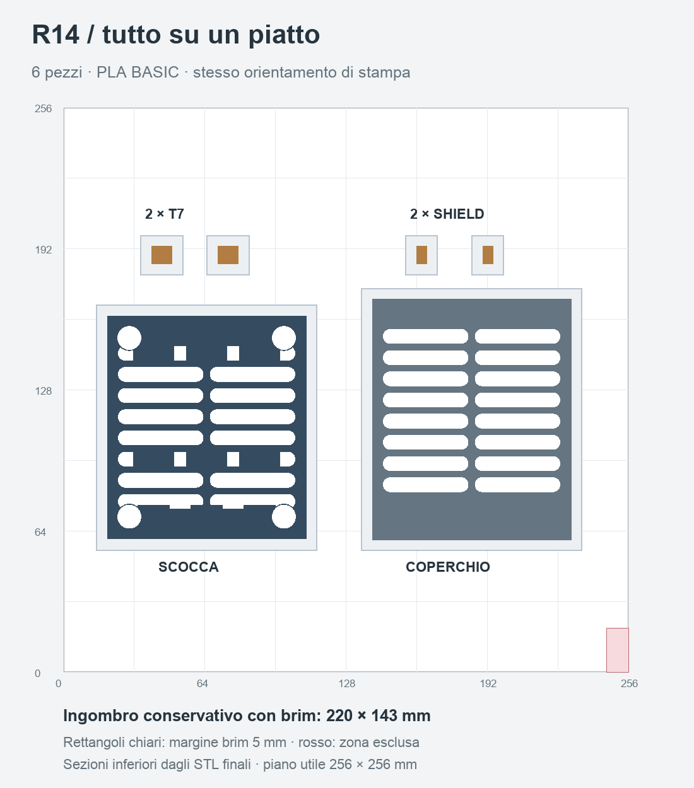
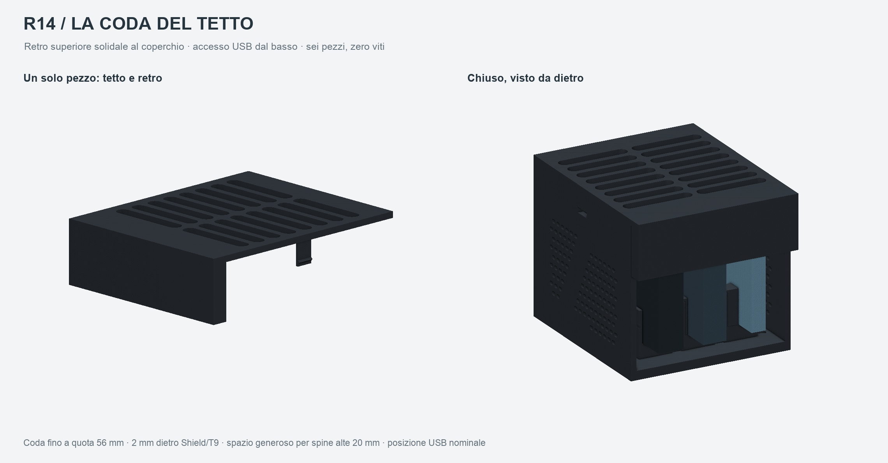

# Bay SSD R14 — coda posteriore, PLA BASIC, S9 in rilievo

Revisione da stampare: **R14, interamente in ELEGOO PLA BASIC per tutte le parti stampate**. Esterno monolitico a spigoli netti, tetto piatto con feritoie orizzontali, pattern laterale orizzontale con fascia diagonale piena. Interno semplice R05 a incastro, coperchio con coda posteriore e fascia USB inferiore aperta, cavi esterni. **Nessuna Fuzzy Skin e nessun provino**, come richiesto. S9 senza sottotitolo, largo **14 mm**, in rilievo **0,4 mm**, nello stesso materiale e colore della scocca.

**Stato: pronto per la stampa del prototipo nominale.** File esportati riaperti, geometria e slicing controllati. Assemblaggio, durata degli scatti, finitura e temperature in uso devono ancora essere verificati sul pezzo reale. Nessuna stampa avviata.



## File da aprire

Aprire in **ElegooSlicer** il progetto unico di `stampa/progetti_ElegooSlicer/`, conservandone orientamenti e impostazioni. È un vero progetto nativo con geometria, profili e percorsi generati dallo slicer.

| Piatto | File | Contenuto |
| --- | --- | --- |
| 01 | `BAY_R14_01_KIT_COMPLETO_ECC2_PLABASIC.3mf` | Scocca, coperchio, due inserti T7, due inserti Shield |

**Tutti i sei pezzi su un solo piatto**, stampati per strato. Scocca e coperchio affiancati, quattro inserti dietro; stessi orientamenti della consegna precedente. Ingombro conservativo comprensivo dei brim da 5 mm: **220 × 143 mm**, da X15 a X235 e da Y55 a Y198 sul piano 256 × 256 mm. Brim separati e zona esclusa della macchina libera.



Stima del piatto unico: **142,38 g di PLA, 8 h 05 min 34 s**, con brim incluso. Dettagli in [RAPPORTO_VERIFICHE.md](verifiche/RAPPORTO_VERIFICHE.md). La R13 resta disponibile separatamente e non viene modificata.

Quattro STL unici in `stampa/STL/`, già orientati e in millimetri: scocca ×1, coperchio ×1, inserto T7 ×2, inserto Shield ×2. **Sei pezzi stampati** per il kit con uno di ciascun SSD. Per altre combinazioni, duplicare gli inserti necessari: due per ogni T7 o Shield, zero per ogni T9, quindi rifare slicing e controlli del piatto modificato.

`CAD/` contiene STEP per ciascuna parte nel riferimento di montaggio e orientata per la stampa. `BAY_R14_ASSIEME_GABARIT.step` comprende i tre ingombri SSD di riferimento: non stamparli. Il logo è fuso nella scocca, senza componente da incollare o cambio colore. I due loghi originali PNG/SVG sono conservati nella root del progetto.

## Coda posteriore del coperchio

Il tetto prosegue indietro di **8 mm** e si piega verso il basso in un pannello di **3 mm** con due corti risvolti laterali. Tetto e coda sono **un solo pezzo stampato**, con gli stessi due agganci del coperchio precedente. Bordo inferiore a **56 mm dalla base**: la parte bassa rimane aperta per collegare e manovrare i cavi.



Per la richiesta di spazio generoso per cavi grossi, il controllo riserva a ogni spinotto un ingombro di **20 mm di larghezza × 20 mm di altezza × 50 mm in uscita**. Le USB sono collocate al centro nominale della faccia corta dei gabarit SSD: margine verticale sotto la coda 3 mm per T9, 3,5 mm per Shield e 4,5 mm per T7. Queste sono ipotesi progettuali modificabili, non uno standard dimensionale USB né misure dei cavi reali. Non sono state aggiunte finestre sagomate o serraggi per gli spinotti.

La parete interna della coda è a Y106; Shield e T9 finiscono a Y104, lasciando **2 mm** nominali dietro il dispositivo. I corti risvolti lasciano **0,3 mm** dalla fine della scocca. L’apertura posteriore fino a quota 56 mm rimane continua. Il coperchio si stampa capovolto sulla faccia esterna del tetto: coda e risvolti crescono in verticale dal tetto, senza supporti aggiunti. Il kit resta di sei pezzi in un unico piatto.

## Configurazione del piatto

| Impostazione | Valore salvato |
| --- | --- |
| Macchina | ELEGOO Centauri Carbon 2 Combo; profilo ECC2 specifico |
| Ugello / piano | 0,4 mm / PEI testurizzato |
| Filamento | ELEGOO PLA BASIC, un solo colore per piatto |
| Ugello / piano | 220 °C / 60 °C |
| Strato / pareti | 0,20 mm / 4 perimetri |
| Riempimento | Gyroid 20% |
| Portata massima | 5 mm³/s, limite conservativo |
| Supporti | Disattivati |
| Brim | Esterno 5 mm, distanza 0,1 mm |
| Fuzzy Skin | Disattivata su tutti i pezzi |
| Multicolore | Un solo filamento; nessuna torre o cambio colore |

Slicing eseguito con **ElegooSlicer app 1.5.3.5 / motore 2.4.2**. Profilo filamento derivato da `Elegoo PLA Basic @ECC2`, con ereditarietà risolta e copia degli originali in `slicer/`. Le temperature rientrano negli intervalli [ELEGOO PLA BASIC](https://www.elegoo.com/products/pla-basic-filament-1-75mm-colored-1kg). Il limite volumetrico originale di 21 mm³/s è ridotto a 5 mm³/s. La bobina specifica non è stata calibrata; il colore disponibile non è stato comunicato. Il grafite delle anteprime è indicativo.

**Stampare con lo sportello anteriore aperto.** Il profilo segnala `bed_temperature_too_high_than_filament`: piano a 60 °C, soglia software PLA a 45 °C. La soglia originale è conservata. Lo sportello aperto limita l’accumulo di calore nella camera durante la stampa del PLA; l’avviso e la preparazione sono registrati nel rapporto.

Pulire il PEI secondo le istruzioni della macchina e controllare il primo strato. Le parti sono già posate sulla faccia prevista: scocca sul fondo, inserti capovolti sul cappello, coperchio capovolto sulla faccia esterna. Dopo il raffreddamento rimuovere brim ed eventuali fili senza arrotondare i piccoli denti degli agganci. La faccia esterna del tetto prenderà la texture del PEI; fronte e fianchi conserveranno le linee degli strati. Il logo ha un rilievo fisico, senza effetto lucido programmato.

Tempi e consumo effettivamente stimati dallo slicer, compreso il brim, sono riportati in [RAPPORTO_VERIFICHE.md](verifiche/RAPPORTO_VERIFICHE.md). Nessun G-code generico o scritto a mano: i percorsi conservati nei 3MF provengono dallo slicer con questa configurazione.

## Dimensioni e montaggio

Scocca base **90 × 101 × 86 mm**; coperchio esteso fino a **109 mm** di profondità. Ingombro chiuso, rilievo S9 incluso: **90 × 109,4 × 86 mm**, prima di spinotti, curva dei cavi e gommini. Shield e T9 terminano a Y104 e rimangono a 2 mm dalla parete interna della coda. Nessun vano che raccolga o costringa i cavi.

Ogni slot ha due piccoli appoggi, apertura nominale **15 mm** e guide alte **18 mm** sopra la seduta. Il T9 si appoggia direttamente; gli altri due usano una coppia di inserti sulla guida destra dello slot scelto.

| Dispositivo nominale | Dimensioni mm | Apertura utile mm | Gioco totale sullo spessore |
| --- | --- | ---: | ---: |
| T7 | 85 × 57 × 8 | 9 con inserti | 1,0 mm, circa 0,5 per lato se centrato |
| T7 Shield | 88 × 59 × 13 | 13,6 con inserti | 0,6 mm, circa 0,3 per lato se centrato |
| T9 | 88 × 60 × 14 | 15 senza inserti | 1,0 mm, circa 0,5 per lato se centrato |

Quote SSD tratte dalle [specifiche Samsung](https://download.semiconductor.samsung.com/resources/brochure/Samsung_Portable_SSD_Brochure.pdf); gli esemplari reali non sono stati misurati. Gli inserti hanno gioco di **0,3 mm per lato** rispetto alla guida e 0,3 mm sopra; il piccolo dente trattiene l’inserto. Non serra l’SSD. Coperchio con due linguette da 1,2 × 8 × 12 mm, gioco laterale 0,3 mm e aggancio nominale 0,6 mm: agganci conservati dalla R13, forza e durata nel PLA non misurate.

1. Eliminare il brim e controllare che i denti siano puliti. Montare una coppia di inserti T7 in uno slot e una coppia Shield in un altro; lasciare libero lo slot T9. Tutti gli slot sono equivalenti.
2. Appoggiare i dischi sul lato lungo, porta USB verso il retro; verificare che restino dritti e possano essere estratti senza forzare.
3. Collegare i cavi dall’esterno. Non usare la trazione dei cavi per trattenere i dischi.
4. Allineare i riferimenti anteriori del coperchio e accompagnare i due agganci laterali. Per riaprire, disimpegnare delicatamente i denti attraverso le finestre laterali; evitare di fare leva sul bordo. Se l’aggancio richiede molta forza, fermarsi e correggere l’accoppiamento.

Nessuna vite, dado, tampone o adesivo interno. Occorrono soltanto i **quattro piedini commerciali trasparenti in gomma**: recessi nominali Ø10,5 × 0,65 mm su piazzole Ø12 mm. Le misure dei piedini non sono confermate. Per una luce di 5 mm sotto la base serve un piedino alto almeno 5,65 mm se incassato completamente; verificare forma e ingombro prima dell’acquisto. Non sono inclusi piedini stampati.

## Ventilazione e limiti della prova digitale

Fondo e tetto aperti fra gli slot, fianchi ventilati, nessun divisorio continuo. La sezione posteriore aperta sotto la coda misura circa **42,84 cm²** senza gli spinotti; il tetto conserva le stesse feritoie. Aree geometriche misurate sulle esportazioni: fondo circa **30,17 cm²**, tetto **37,91 cm²**, fianco **6,96 cm²** ciascuno. Corridoi verticali conservativi con tre T9: **15,19 cm²**. Sono sezioni libere, non misure di portata o dissipazione; nessuna ventola, filtro o attacco ventola aggiunto. Lasciare libere le aperture e rialzare la base con i piedini.

I file superano i controlli nominali sulle nove coppie modello/slot e sulle 27 disposizioni possibili. Rimangono da verificare sul pezzo la stabilità con i cavi collegati, l’accoppiamento reale, la forza e la durata degli scatti in PLA. Nessun provino aggiunto alla consegna.

L’idoneità termica del PLA per questo uso **non è ancora provata**. Confrontare l’uso degli SSD dentro e fuori dal bay con carichi rappresentativi, osservando soprattutto il disco centrale e misurando anche le temperature nelle zone degli appoggi in PLA. Una lettura della temperatura interna dell’SSD non sostituisce la misura delle superfici di contatto. Registrare eventuali deformazioni o allentamenti degli incastri. Non attribuire al PLA una temperatura d’uso validata sulla sola base del modello.

## Sorgenti e controlli

Parametri modificabili in `sorgenti/parametri.json`; sorgenti CadQuery e dipendenze fissate in `sorgenti/requirements.txt`. Riproduzione con Python 3.11 e ambiente dedicato:

```sh
python -m pip install -r sorgenti/requirements.txt
python sorgenti/genera.py
python sorgenti/verifica.py
python sorgenti/stampa.py --slice
python sorgenti/revisiona_percorsi.py
python sorgenti/anteprime.py
```

L’eseguibile predefinito è quello installato in `/Applications/ElegooSlicer.app`; `--slicer` consente un percorso diverso, da verificare prima dell’uso. `confronta_revisioni.py` è un controllo facoltativo di regressione che richiede la R13 nella cartella sorella. La rigenerazione dei modelli e dei piatti non richiede la R13.

La revisione visiva resta un passaggio esplicito: dopo ogni modifica rigenerare e controllare le tavole, quindi aggiornare `verifiche/revisione_visiva.json` con i riscontri effettivamente osservati. `consegna.py` verifica hash, geometria, progetto, impostazioni e revisione visiva prima di creare l’archivio; una revisione precedente non valida nuovi percorsi. Per rigenerare soltanto l’anteprima della disposizione usare `python sorgenti/anteprime.py --plate-only`. I report distinguono controlli digitali e prove fisiche. La R13 e i provini delle finiture precedenti restano separati e invariati.
