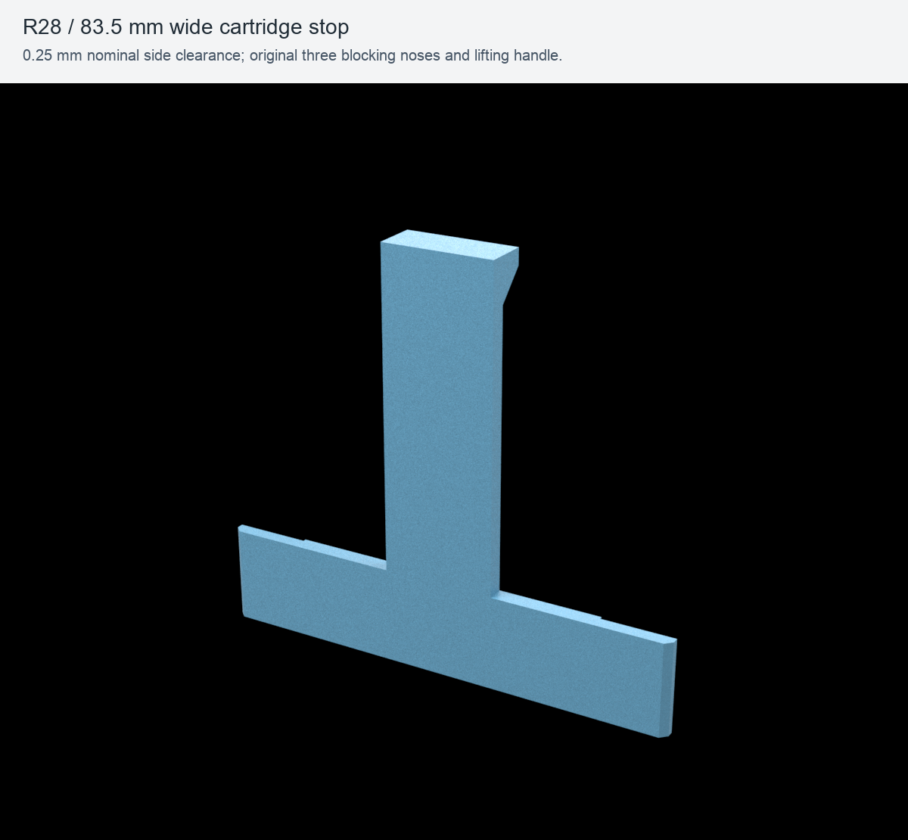
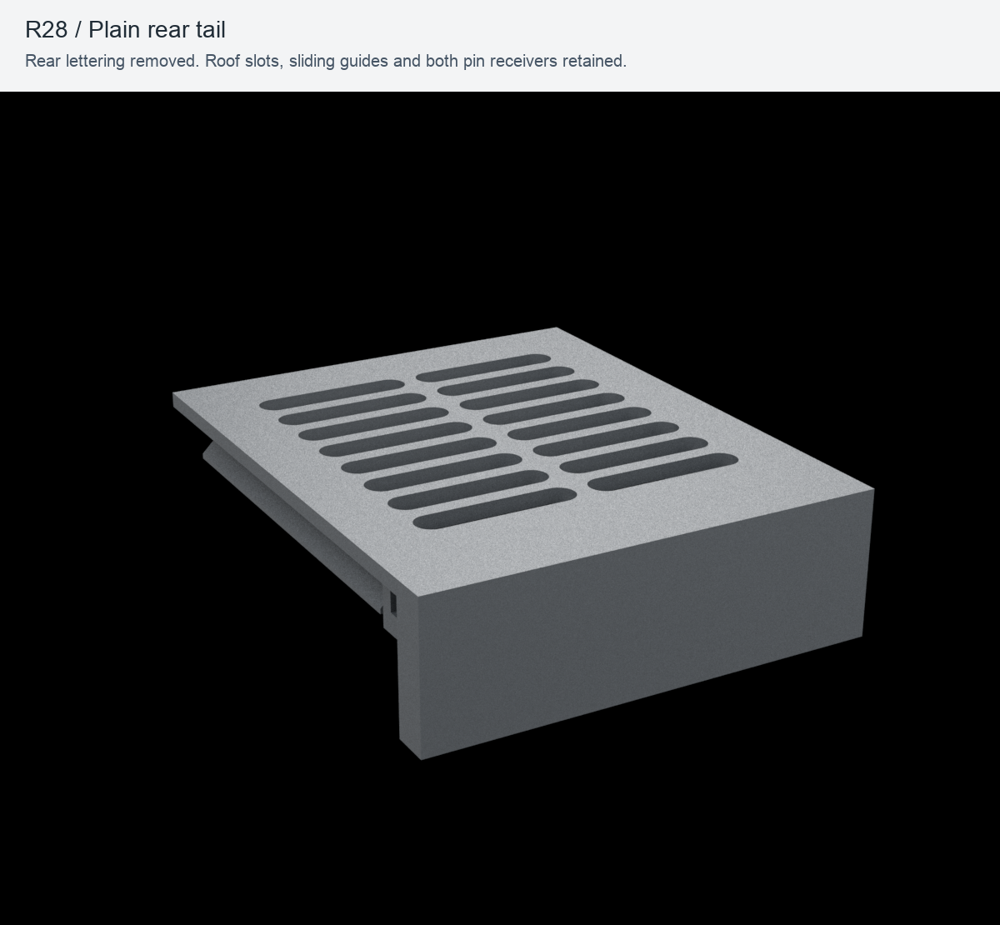
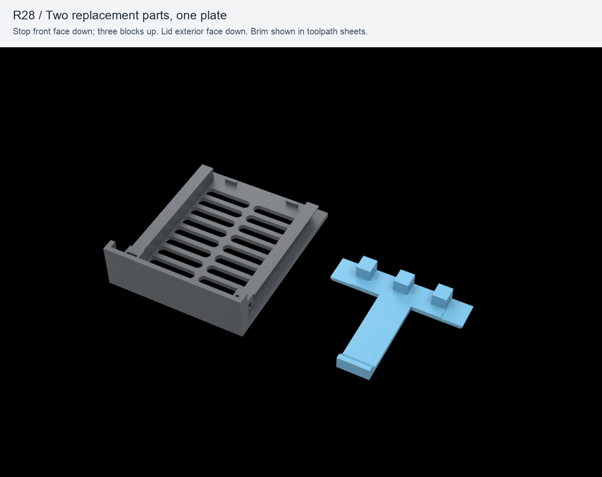
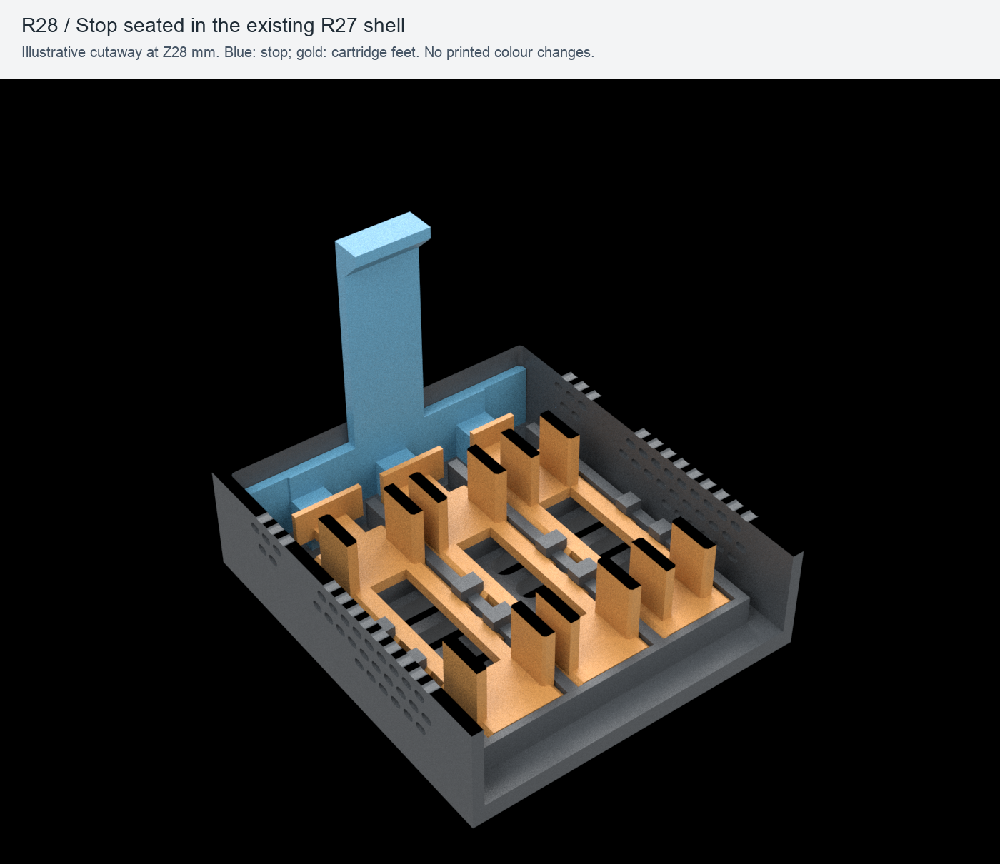

# S9 Monolith Bay — R28 replacement parts

**83.5 mm wide cartridge stop and a plain rear lid, compatible with the existing R27 shell, cartridges and two locking pins.** Print one of each replacement part. The front S9 logo stays on the existing shell.

Status: **Ready for printing** with the reference setup below, following exported-file, nominal assembly and sliced-path checks. R28 printed fit has not yet been confirmed. This is a local revision; the published v1.0.0 / R27 package is preserved.



## What changed

| Feature | R27 | R28 |
| --- | ---: | ---: |
| Cartridge-stop width | 57 mm | **83.5 mm** |
| Width added at each end | — | **13.25 mm** |
| Nominal clearance in the 84 mm shell cavity | 27 mm total | **0.25 mm per side / 0.50 mm total** |
| Rear lid lettering | Raised S9 Engineering | **Removed** |

The two added wings have 1.2 mm front corner chamfers to clear the shell's internal corner radii. Their 2.4 mm depth leaves 0.4 mm nominal clearance in front of the upper roof guides during vertical removal. The original 3 mm central beam, lifting handle, three noses and their spacing are retained.



The rear tail, cable opening, sliding guides and both locking-pin receivers retain the R27 geometry. No new hardware or internal adhesive is needed.

## Choose a print project

All three files are **native, sliced ElegooSlicer projects** with saved machine/material settings and object overrides. They are alternative layouts; printing all three would produce duplicate parts.

| What to print | Native 3MF | Slicer estimate including brim |
| --- | --- | --- |
| **Stop only — recommended first** | [r28-stop-ecc2-pla-basic.3mf](print/slicer/r28-stop-ecc2-pla-basic.3mf) | **31 min 23 s / 9.54 g** |
| Plain rear lid only | [r28-lid-ecc2-pla-basic.3mf](print/slicer/r28-lid-ecc2-pla-basic.3mf) | **2 h 11 min 22 s / 39.58 g** |
| Stop + lid on one plate | [r28-both-ecc2-pla-basic.3mf](print/slicer/r28-both-ecc2-pla-basic.3mf) | **2 h 40 min 50 s / 48.59 g** |

The separate layouts and combined layout have slightly different brim/path totals. Times and consumption are estimates from the actual slicing runs.

For another printer/profile, import the print-oriented STLs in **millimetres**:

| Part | Quantity | STL | Print envelope X × Y × Z |
| --- | ---: | --- | --- |
| Wide cartridge stop | 1 | [cartridge-stop-r28.stl](print/stl/cartridge-stop-r28.stl) | 83.5 × 74 × 10.9 mm |
| Plain rear lid | 1 | [lid-plain-r28.stl](print/stl/lid-plain-r28.stl) | 90 × 109 × 29 mm |



1. Open the chosen 3MF as a **project**, retaining its supplied orientation and configuration for the reference machine.
2. Use PLA, clean the build plate and check the selected filament/channel. The file uses a single material and no purge tower.
3. Print, let the plate cool and remove the brim and any strings from the contact edges. The stop's **flat front face is on the plate, with the three blocks facing up**. The lid's **exterior roof face is on the plate**.
4. Install the stop first to check the fit in your existing shell. The lid can be printed separately afterwards, or both can be printed together using the combined project.

## What you need

- PLA filament and a brim-removal/deburring tool.
- Existing R27 shell, three model-specific cartridges and two hidden quarter-turn pins.
- The existing SSDs, USB cables and external feet when reassembling the complete bay.

The replacement requires **no screws, nuts, inserts, glue or extra fittings**.

## Install the wider stop



*Blue identifies the stop and gold identifies the cartridge feet. Walls and cartridge frames are cut away above Z28 mm for visibility; actual parts remain intact.*

1. Disconnect the USB cables, unlock the two existing pins and slide the lid towards the rear to remove it.
2. Lift the old common stop straight up using its handle. Leave the three cartridge feet fully seated under the base tabs.
3. Lower the new stop between the front wall and the cartridge feet, with the **three blocks pointing towards the cartridges**. The wider crossbar sits across the front of the cavity and rests on the floor; nothing goes underneath the cartridge feet.
4. Check that it reaches the floor without forcing the side walls. The target side play is **0.50 mm total**, rather than the former 27 mm nominal travel. Each of the three blocks must remain opposite its cartridge tongue.
5. Check that the cartridges cannot slide forwards enough to leave their base tabs, then lift the stop straight out and refit it. The upper guides must remain clear during removal.
6. Fit the new plain rear lid on the existing guides and reuse both pins. Connect the USB cables through the existing lower rear opening.

## My setup

| Item | Reference configuration |
| --- | --- |
| Printer | ELEGOO Centauri Carbon 2 Combo |
| Installed printer profile | Elegoo Centauri Carbon 2 0.4 nozzle, ECC2 family |
| Nozzle / plate | 0.4 mm / textured PEI |
| Filament | ELEGOO PLA BASIC, 1.75 mm, one colour/channel |
| Slicer | ElegooSlicer 1.5.3.5, engine 2.4.2 |
| Layer height / walls | 0.20 mm / 4 |
| Infill | 20% gyroid |
| Lid wall generator | Arachne |
| Nozzle / bed | 220 °C / 60 °C |
| Volumetric flow limit / bridge speed | 5 mm³/s / 25 mm/s |
| Brim | Outer, 5 mm, 0.10 mm object gap |
| Elephant-foot compensation | 0.10 mm |
| Supports / raft / fuzzy skin / purge tower | Disabled |
| PLA enclosure preparation | Front door open |

The slicer reports `bed_temperature_too_high_than_filament` for the saved 60 °C bed configuration. This is the existing PLA/enclosure warning; use the open-door preparation above. No other slice warning was accepted. Filament flow and pressure-advance values remain the existing reference settings rather than newly calibrated measurements.

The optional files in [print/gcode](print/gcode) were produced by the actual slicer for this exact setup. Use the STL files and reslice when changing equipment or filament configuration.

## Editable files and verification

- [Parameters](source/parameters.json), [CAD generator](source/generate.py) and [STEP exports](cad).
- [Geometry and compatibility report](verification/geometry.json): reopened STEP/STL, one solid per part, closed meshes, winding, volume, degenerate/duplicate faces, self-intersection screening, clearances and nominal assembly checks for all nine cartridge/position combinations.
- [Slicer evidence](verification/slicing): all layers rendered from the real G-code, first/middle/last layers, bridge details and the two pin receivers. Exported 3MF transforms, units, mesh correspondence, plate exclusions, brim and embedded G-code were checked.
- [Reference profile provenance](verification/profile-provenance.json) and [delivery status](verification/delivery.json).

Nominal CAD checks and toolpath inspection do not establish physical fit or retention. The 0.25 mm side gap must still be checked on the printed shell. The self-intersection screen excludes triangle pairs sharing a vertex. No printer job has been sent.

To regenerate from the repository root, create a CAD environment with [requirements.txt](source/requirements.txt), then run:

```sh
python3 -m venv .venv-cad
.venv-cad/bin/python -m pip install -r versions/r28-stop-wings-plain-rear/source/requirements.txt
.venv-cad/bin/python versions/r28-stop-wings-plain-rear/source/generate.py
.venv-cad/bin/python versions/r28-stop-wings-plain-rear/source/verify.py
.venv-cad/bin/python versions/r28-stop-wings-plain-rear/source/slice.py
```

`slice.py` requires the recorded ElegooSlicer installation and verified ECC2 profile resources. Reference geometry is read from the existing [project-contained R27 STEP exports](../../cad). Optional technical previews use [render.py](source/render.py), [requirements-render.txt](source/requirements-render.txt) and the existing project-contained R27 assembly meshes.

Design/documentation: [CC BY-NC-SA 4.0](../../LICENSE.txt). Original S9 software: [PolyForm Noncommercial 1.0.0](../../LICENSE-SOFTWARE.txt). See [licensing scope and logo terms](../../LICENSING.md).
